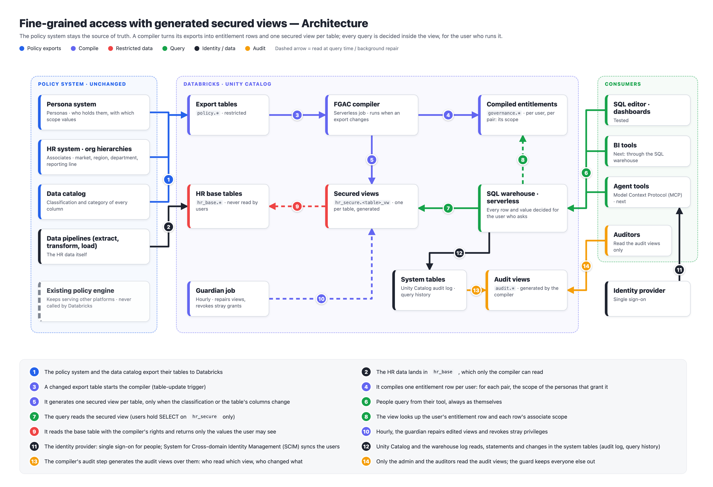

# FGAC: fine-grained access on Databricks with generated secured views

A proof of concept that enforces an existing policy system's row and column rules on Databricks, with nothing
re-modelled in Databricks. The policy system (personas, their scopes, column classifications) stays the source of
truth and exports a few tables. A compiler turns those tables into one entitlement row per user and one generated
**secured view** per table. Users can read only the views. Every row and value is decided inside the view for the
user who runs the query: values they may not see come back as `NULL`.

> **Sample code, provided as is.** This is a proof of concept, not a supported Databricks product. It uses only
> synthetic data. Review it, and test it in your own workspace, before you rely on it.



## How it works

1. **Exports.** The policy system exports five tables into a restricted schema, `policy`: `assoc_dim` (associates and
   their resolved hierarchies: market, region, department, reporting line), `assoc_roles_dim` (who holds which persona,
   with which scope values), `persona` (each persona's scope type), `persona_column_policy` (the classification and
   category pairs each persona may see), and `column_classification` (each column's business term, classification and
   category).
2. **Compile.** A serverless job, `fgac-compiler`, starts whenever an export changes (table-update trigger). It runs as
   a compiler service principal, which owns the catalog. It writes:
   - `governance.user_entitlement`: one row per user. For every (classification, category) pair the user may see, it
     holds the union of the scopes of the personas that grant that pair, so a grant never reaches beyond the scope of
     the persona that gives it. Every change is kept in `governance.user_entitlement_history`.
   - one view per classified table, `hr_secure.<table>_vw`, regenerated only when the classification or the table's
     columns change (or the view was edited by hand). A persona, scope or assignment change never touches a view.
   - six **audit views** in `audit`, over the Databricks system tables (the Unity Catalog audit log and the query
     history) and the entitlement history: who read which secured view and with which personas, every statement on
     the catalog, direct reads of the restricted tables, every governance change (privileges, owners, objects created
     or dropped, refused attempts included) and who made it, every entitlement change, every compile. Only the admin
     and the configured `auditors` can read them.
   - **guard**: revokes any privilege that should not exist on the restricted schemas or the audit schema, and
     repairs ownership.
   - **invariants**: fourteen checks that fail the job if users could see more than the policies allow.
3. **Query.** Every user holds `SELECT` on `hr_secure` only. The view reads the user's own entitlement row
   (`session_user()`) and the base table with the owner's rights:
   - **Rows**: any persona other than Self: every row. Only Self: their own row. No persona: nothing.
   - **Columns**: Non-Sensitive values are visible on every row the user sees. Any other value is visible only if one of
     the user's personas grants the column's pair **and** covers the row (Enterprise: every row; Market, Region,
     Department, Reporting line: the associate's place in `assoc_dim`; Self: the user's own record).
   - **Unclassified** columns count as Highly Sensitive (configurable: `unclassified_rule`).

All seven, inline: [diagrams/](diagrams/README.md).

| Diagram | |
| :---- | :---- |
| [Data model](diagrams/02_data_model.png) | every table and view, with the columns that connect them |
| [How a value is decided](diagrams/03_value_decision.png) | the decision for each row and cell |
| [A query, step by step](diagrams/04_seq_query.png) | one query through the SQL warehouse |
| [What happens when things change](diagrams/05_changes.png) | persona changes, new classifications, tampering |
| [The guide at a glance](diagrams/06_runbook.png) | how docs/HOW_TO_RUN.md is organised |
| [Onboarding a table](diagrams/07_onboarding.png) | the seven steps to open a table up, and what each one is on Databricks |

## What it shows

- The same SQL gives each person a different answer, decided by their personas only. Being an admin of the workspace
  gives no data through the views.
- A change in the policy exports (one more market for a person, one more column for a persona, an associate who moves
  or leaves) reaches the views by itself through the next compile. No view or grant is edited by hand.
- Attempts to get around the views fail: reading the base or export tables, replacing or copying a view, time travel,
  guessing hidden values with filters, aggregates, joins or sorting, and errors raised on hidden rows.
- An audit trail with no extra logging: who read which view, holding which personas at that moment; who tried to
  change what (and was refused); every entitlement change. The auditors read it without seeing any HR data.
- The same secured views on a serverless SQL warehouse and on a Lakehouse Real-Time warehouse (read-only).

## Quick start

You need a Databricks workspace (with serverless SQL and serverless jobs), workspace admin and account admin rights,
`CREATE CATALOG`, metastore admin (to let the compiler read the system tables for the audit views), the Databricks CLI, and Python 3.11 with `databricks-sdk`. The full guide is
[docs/HOW_TO_RUN.md](docs/HOW_TO_RUN.md).

```sh
git clone https://github.com/dipankarkush-db/FGAC.git && cd FGAC
python3 -I -m pip install --upgrade "databricks-sdk>=0.158"
databricks auth login --host https://<your-workspace-url> --profile <workspace-profile>
databricks auth login --host https://<accounts-console-url> --account-id <your-account-id> --profile <account-profile>
cp config.example.json config.json        # fill in the first five keys
python3 -I poc.py deploy --verify         # builds everything and runs the automated tests (about 11 minutes)
python3 -I poc.py act-as mm_market_abc    # your login now holds the Market Manager's personas
```

Then, in the SQL editor on the warehouse `fgac-poc`:

```sql
SELECT win, employee_name, market, region, department, base_salary, bonus, ssn
FROM fgac_poc.hr_secure.associate_compensation_vw
WHERE win BETWEEN 50001 AND 50006 ORDER BY win;
```

Remove everything with `python3 -I poc.py destroy --yes`.

## Commands

| Command | What it does |
| :---- | :---- |
| `python3 -I poc.py deploy [--verify] [--rebuild-data]` | build whatever is missing: warehouses, test users, catalog, synthetic data, grants, jobs; then compile. `--verify` runs the tests |
| `python3 -I poc.py status` | what exists, and which personas your own login holds |
| `python3 -I poc.py act-as <persona>` / `act-as none` | give your login a test user's policy rows (or none), then wait for the compile |
| `python3 -I poc.py run-job [compiler\|guardian]` | run a job once and wait for it |
| `python3 -I poc.py destroy --yes` | remove everything the deploy created |
| `python3 -I tests/test_audit.py` | the audit trail end to end: makes reads, refused attempts and a stray grant, then finds each in the audit views (waits for the system tables, up to 30 minutes) |
| `python3 -I dbsql.py [--as <user>] [--rt] "SQL"` | run SQL as you, a test user or the compiler; `--rt` on the Real-Time warehouse |
| `python3 -I large_data.py load \| act-as \| status \| compile \| users \| remove --yes` | the optional large synthetic data set (docs/HOW_TO_RUN.md, Appendix F) |

## Repository layout

| Path | What it is |
| :---- | :---- |
| `config.example.json` | every setting; copy it to `config.json` (git-ignored) and fill it in |
| `config.py` | reads the settings; the test users |
| `poc.py` | deploy, status, persona switch, jobs, destroy |
| `dbsql.py` | runs SQL through the SQL warehouse (Statement Execution API) |
| `compiler/fgac_compiler.py` | the compiler: `entitlements`, `views`, `audit`, `guard` |
| `databricks.yml` | the two serverless jobs (Databricks Asset Bundle) |
| `setup/01_catalog_and_hr_data.sql` | the catalog, its five schemas, the synthetic HR base tables |
| `setup/02_policy_exports.sql` | the synthetic policy exports, including the test users' personas |
| `tests/` | correctness (an independent oracle), exfiltration, invariants, the audit trail |
| `large_data.py` | the optional large synthetic data set, in its own catalog |
| `docs/HOW_TO_RUN.md` | the step-by-step guide: deploy, demo and test, remove, troubleshooting |
| `diagrams/` | the seven diagrams (PNG), shown inline in `diagrams/README.md` |

## Design choices you can change

| Choice | Default | Where |
| :---- | :---- | :---- |
| An unclassified column | counts as Highly Sensitive (any Highly Sensitive grant shows it, within that persona's scope); `restricted` hides it from everyone | `unclassified_rule` |
| A person with only Self | sees only their own row | the compiler |
| A person with no persona | sees nothing | the compiler |
| A table without an associate key | only Enterprise personas see its sensitive values | the compiler |
| A person who has left (`assoc_dim.status`) | their records stay governed by their last hierarchy; their own login gets nothing | `terminated_statuses` |
| Hierarchy types | market, region, department, reporting line | `SCOPE_NODE` in the compiler |
| Who may read the audit views | only the admin; list users, groups or service principal application IDs to give them USE SCHEMA and SELECT on `audit` (nothing else) | `auditors` |
| What the audit views show of SQL text | string and number values in statements and error messages are shown as `?`, so values someone typed never reach the auditors; `full` shows the text as run | `audit_statement_text` |
| How a view checks scope | `join` (the user's scope nodes joined once per query); `array` gives the same answers | `scope_check` |

Bad export rows fail closed: a role row without a login, a login with two associate IDs, a persona with two scope types,
or a policy row without a classification or category grants nothing, and an invariant names it.

## Lakehouse Real-Time

The deploy also creates a Lakehouse Real-Time warehouse (`realtime_warehouse_name`) when the workspace's
**Lakehouse RT** preview is on. It is read-only: the compiler and every change run on the serverless SQL warehouse,
and users can read the same views on either. Lakehouse Real-Time is a preview: check its status and limits for your
workspace with your Databricks account team.

## License

[Apache License 2.0](LICENSE). Provided as is, without warranty or support; not a Databricks product.
