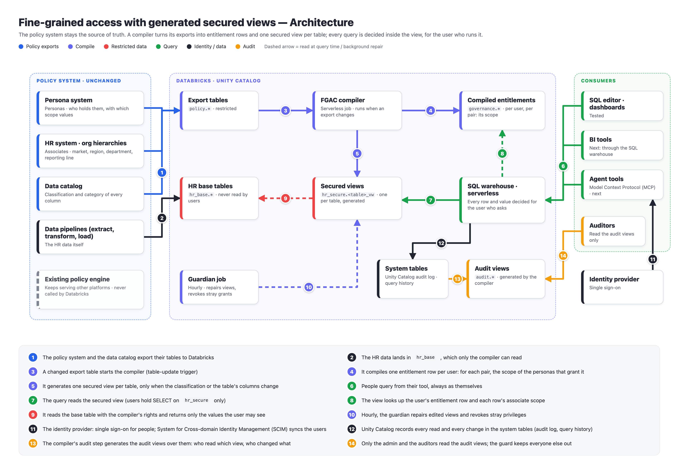
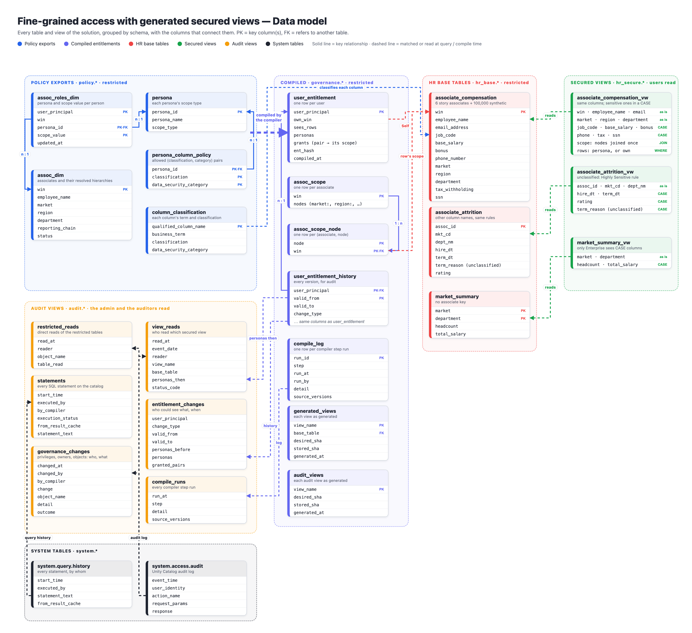
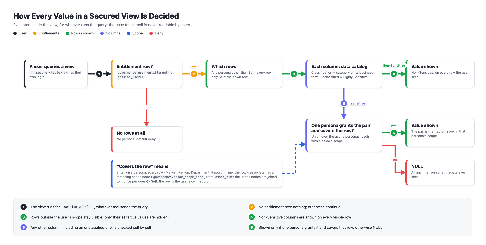
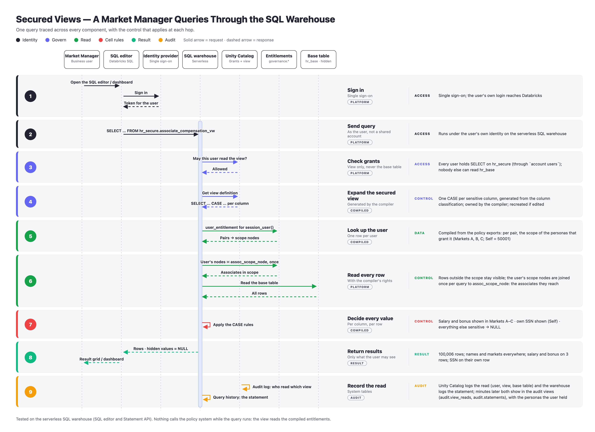
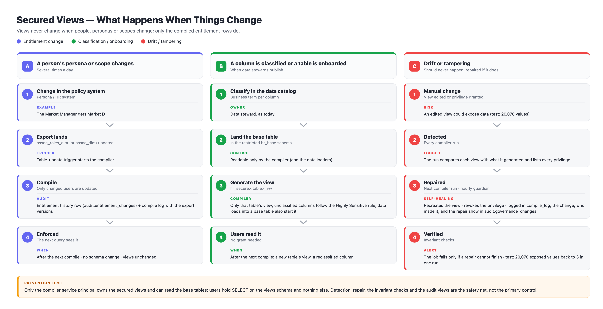
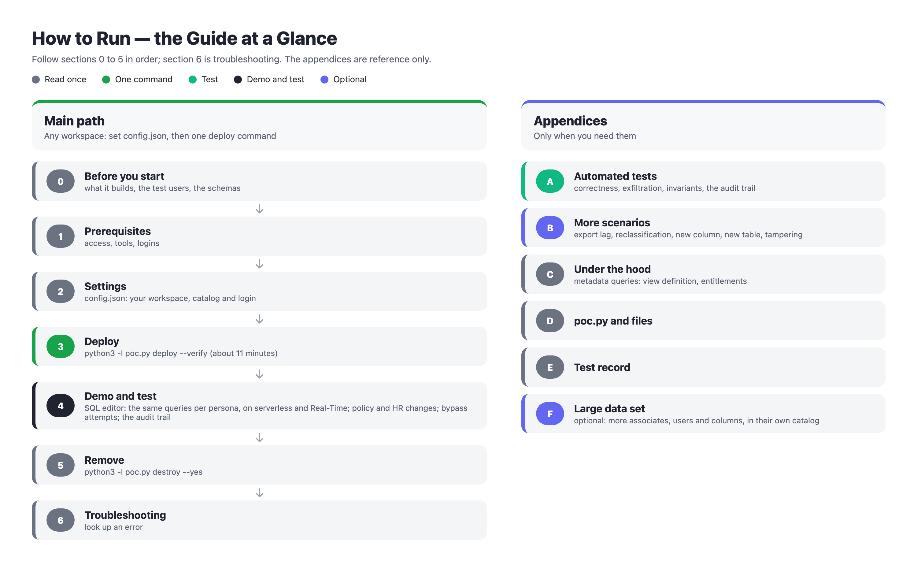
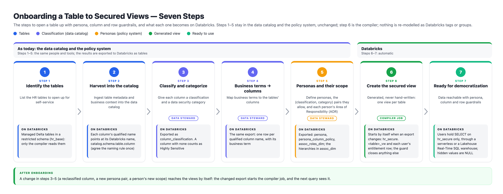

# Diagrams

| # | Diagram | What it shows |
| :---- | :---- | :---- |
| 01 | [Architecture](#01-architecture) | the policy exports, the compiler, the secured views, the consumers, the audit views |
| 02 | [Data model](#02-data-model) | every table and view (the audit views and the system tables they read included), with the columns that connect them |
| 03 | [How a value is decided](#03-how-a-value-is-decided) | the decision for each row and cell |
| 04 | [A query, step by step](#04-a-query-step-by-step) | one query through the SQL warehouse, and how it is recorded for audit |
| 05 | [What happens when things change](#05-what-happens-when-things-change) | persona changes, new classifications, tampering (and where each is recorded) |
| 06 | [The guide at a glance](#06-the-guide-at-a-glance) | how [docs/HOW_TO_RUN.md](../docs/HOW_TO_RUN.md) is organised |
| 07 | [Onboarding a table](#07-onboarding-a-table) | the seven steps to open a table up, and what each one is on Databricks |

## 01 Architecture

## 02 Data model

## 03 How a value is decided

## 04 A query, step by step

## 05 What happens when things change

## 06 The guide at a glance

## 07 Onboarding a table

