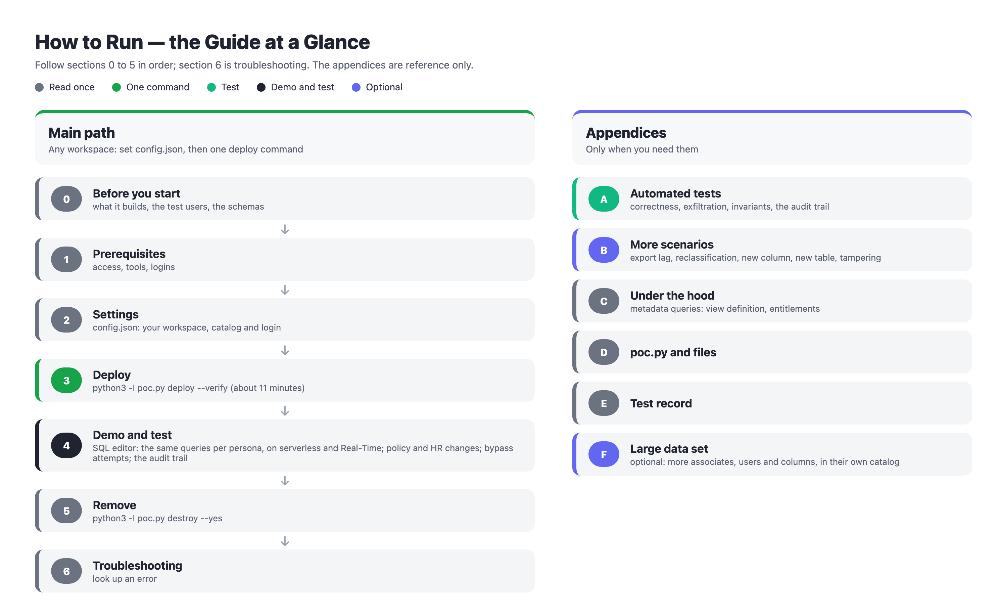

# How to run the POC, step by step

| | |
| :---- | :---- |
| What | Build, demo, test and remove the proof of concept: fine-grained access (rows and columns) on Databricks through generated secured views |
| Tested | Deployed from nothing from this repository and run as printed, in a Databricks test workspace with synthetic data (Appendix E) |
| Scope | Functional and security tests (section 4, Appendix A); an optional large synthetic data set (Appendix F) |

## 0\. Before you start

**How to use this guide.** Follow sections 0 to 5 in order; section 6 is for looking up errors. The appendices are reference only.



| Section | What you do | Time |
| :---- | :---- | :---- |
| 1\. Prerequisites | check your access, install the tools, log in | 10 minutes |
| 2\. Settings | copy `config.example.json` to `config.json` and fill it in | 2 minutes |
| 3\. Deploy | one command builds and checks everything | about 11 minutes |
| 4\. Demo and test | in the SQL editor: the same queries for each persona, then policy and HR changes, before and after; at the end the audit trail of it all | about 90 minutes |
| 5\. Remove | one command removes everything | about 3 minutes |
| 6\. Troubleshooting | look up an error | as needed |

**What it builds**, all in one catalog, `fgac_poc`:

| Schema | What it is | Who can read it |
| :---- | :---- | :---- |
| `hr_base` | the HR base tables: `associate_compensation` (six story associates 50001–50006, plus 100,000 synthetic), `associate_attrition`, `market_summary` | only the compiler (owner) and you, the admin |
| `hr_secure` | one generated secured view per base table: `<table>_vw` | every user; the view decides what each one sees |
| `policy` | the tables the policy system exports (synthetic): `assoc_dim`, `assoc_roles_dim`, `persona`, `persona_column_policy`, `column_classification` | only the compiler and you |
| `governance` | compiled entitlements (`user_entitlement`, `assoc_scope`), their history, the compiler log | only the compiler and you |
| `audit` | six generated audit views over the Databricks system tables (the Unity Catalog audit log, the query history) and the governance history: `view_reads`, `restricted_reads`, `statements`, `governance_changes`, `entitlement_changes`, `compile_runs` (section 4.10) | only you and the configured auditors (`auditors`, section 2) |

Plus: the serverless SQL warehouse `fgac-poc`; the Lakehouse Real-Time warehouse `fgac-rt` (read-only, for section 4.4; created only when the workspace's Lakehouse RT preview is on); the jobs `fgac-compiler` (runs whenever the data of an export table or a base table changes) and `fgac-guardian` (hourly, paused; it runs the compiler job); ten service principals `fgac-*` (nine test users and the compiler).

**The test users.** Service principals that stand in for people; the views treat them exactly like people. `poc.py act-as` gives your own login the same policy rows (section 4.0 explains how).

| Key | Plays | `win` (associate ID) in its policy rows (its "own record" for Self) |
| :---- | :---- | :---- |
| `mm_market_abc` | Market Manager, Markets A, B, C; plus Self | 50001 (Alex Morgan) |
| `rhrd_south` | Regional HR Director, Region South | 20000002 (no Self) |
| `hrbp_hr` | HR Business Partner, HR department | 20000003 (no Self) |
| `people_analyst` | People Analyst, enterprise scope; Sensitive compensation and Sensitive organization | 20000004 (no Self) |
| `people_mgr` | People Manager, reporting line; plus Self | 50005 (Samuel Reed) |
| `senior_mgr` | People Manager two levels up (Samuel Reed reports to him); plus Self | 50001 (Alex Morgan) |
| `multi_persona` | two personas: People Analyst, and Market Manager for Market A | 20000006 (no Self) |
| `self_only` | Self only | 50004 (Maria Lopez) |
| `no_persona` | no persona at all | none |

**How the steps are written.**

- **In the terminal**: run it in the repository folder (macOS zsh or Linux bash). Every Python command uses `python3 -I`.  
- **In the SQL editor**: open SQL editor in the workspace, pick the warehouse `fgac-poc`, paste and run.  
- **Expected**: what you should see. If you see something else, go to section 6\.

**Data sensitivity.** All data is synthetic. Never load real personal data into this POC.

## 1\. Prerequisites

### 1.1 Access you need

| Need | Why |
| :---- | :---- |
| Workspace admin | create the service principals and the SQL warehouse |
| Account admin (account login) | let you deploy jobs that run as the compiler; delete the principals in the account on removal |
| `CREATE CATALOG` on the metastore | the deploy creates one catalog |
| Metastore admin (or the owner of the `system` catalog) | let the compiler read the system tables `system.access` (audit log) and `system.query` (query history) for the audit views; without it the deploy prints a warning and the job's `audit` task fails (section 6) |
| Serverless SQL and serverless jobs | everything runs on serverless |

### 1.2 Local tools

```sh
databricks --version
python3 -I --version
python3 -I -m pip install --upgrade "databricks-sdk>=0.158"
```

Expected: a CLI version (tested with v1.17.0), Python 3.11, and the SDK installed (tested with 0.158.0; the deploy uses its service principal secret API).

### 1.3 Get the code and open a terminal in it

```sh
git clone https://github.com/dipankarkush-db/FGAC.git
cd FGAC
ls
```

Expected: `LICENSE  README.md  compiler  config.example.json  config.py  databricks.yml  dbsql.py  docs  large_data.py  poc.py  setup  tests`.

### 1.4 Log in with the Databricks CLI

Two logins: the workspace and the account.

```sh
databricks auth login --host https://<your-workspace-url> --profile <workspace-profile>
databricks auth login --host https://<accounts-console-url> --account-id <your-account-id> --profile <account-profile>
databricks auth profiles
```

The accounts console URL is `https://accounts.azuredatabricks.net` on Azure, `https://accounts.cloud.databricks.com` on AWS and `https://accounts.gcp.databricks.com` on Google Cloud. Expected: a browser login each time; both profiles show `YES` under Valid. Log in again whenever a command says the token expired.

## 2\. Settings

Every environment setting is in `config.json` (the synthetic data and the test users are in the setup SQL). It is not in the repository (`.gitignore`): copy the example and fill in the first five keys; the others can stay as they are.

```sh
cp config.example.json config.json
```

| Key | Meaning | Example |
| :---- | :---- | :---- |
| `profile`, `host` | workspace CLI profile and URL | `<workspace-profile>`, `https://<your-workspace-url>` |
| `account_id`, `account_profile` | the Databricks account and its CLI profile | `<your-account-id>`, `<account-profile>` |
| `admin` | your login | `you@your-company.com` |
| `warehouse_name` | the SQL warehouse the deploy creates (found by name) | `fgac-poc` |
| `realtime_warehouse_name` | the Lakehouse Real-Time warehouse the deploy creates for section 4.4 (needs the workspace's Lakehouse RT preview; without it the deploy skips it with a note, and everything else works) | `fgac-rt` |
| `catalog` | the POC catalog | `fgac_poc` |
| `sp_prefix` | name prefix of the service principals | `fgac-` |
| `job_prefix` | name prefix of the two jobs | `fgac-` |
| `sp_creds_file` | where their secrets are written (local only, never in shared storage) | `~/.fgac_principals.json` |
| `unclassified_rule` | `highly_sensitive` (the default: anyone with Highly Sensitive access sees unclassified columns) or `restricted` (never shown) | `highly_sensitive` |
| `etl_principals` | optional: the identities that load data (ETL, the policy export job); the compiler's guard leaves their privileges alone | not set |
| `auditors` | optional: who may read the audit views (users, groups, or service principal application IDs); they get USE SCHEMA and SELECT on `audit` only, and the guard revokes anything else there. You, the admin, can always read them | `[]` (only you) |
| `terminated_statuses` | the `assoc_dim.status` values of people who have left: their own login gets no entitlement (section 4.8) | `["Terminated"]` |
| `large_data` | the optional large data set (Appendix F): its catalog, number of associates, and the warehouse that builds it | see `config.example.json` |
| `scope_check` | how a view checks a persona's scope: `join` (the design: the person's nodes joined once per query to `governance.assoc_scope_node`) or `array` (an alternative form with the same answers) | `join` |

## 3\. Deploy

One command builds everything that is missing, runs the compiler job once and runs the automated tests. It is safe to run again: it builds only what is missing.

```sh
python3 -I poc.py status
python3 -I poc.py deploy --verify
```

It creates, in order: the SQL warehouse; the ten service principals (nine test users and the compiler) and their secrets; the catalog with the HR base tables and the policy exports (`setup/01_catalog_and_hr_data.sql`, `setup/02_policy_exports.sql`); the grants (the compiler owns everything; `account users` may read `hr_secure` only; the compiler may read the system tables `system.access` and `system.query`, for the audit views); the two jobs (Databricks Asset Bundle); then the first compile, through the compiler job, whose steps are `entitlements`, `views`, `audit` (the audit views in `audit`), `guard` and `invariants`. `--verify` then runs the test suites of Appendix A.

Expected (about 11 minutes from nothing), ending with:

```
=== compile, as the compiler service principal
    running fgac-compiler ...
    fgac-compiler: SUCCESS
=== verify
...
0 failure(s)          (correctness: 27 PASS lines)
...
0 failure(s)          (exfiltration: 29 PASS lines)
Deploy finished. Check with: python3 -I poc.py status
```

The compile's own output (`entitlements: 1584 users; changes {'GRANTED': 1584}`, `views: 3 secured views, 3 (re)created`, `audit: 6 audit views, 6 (re)created`, `guard: 0 unexpected privilege(s) or owner(s) fixed`, then the 14 invariants) is in the job run's task output, under Jobs & Pipelines → `fgac-compiler`.

Then `python3 -I poc.py status` shows both warehouses (the Real-Time one only if the preview is on), 10 of 10 principals, the catalog, `audit views ... 6; auditors: none but you`, both jobs `present`, and your login with no persona.

A copy deployed before the audit layer is upgraded by the same command: `deploy` creates the `audit` schema and the system-table grants, uploads the job with its new `audit` task and compiles; the data is kept.

## 4\. Demo and test (about 90 minutes, most of it waiting; in the SQL editor)

One flow is both the demo and the functional test. Every result is shown with plain SQL in the workspace's **SQL editor**; the terminal is used for switching persona with `poc.py act-as`, and, as the one exception, for section 4.9 (attempts to get around the views, run as a test user).

The flow:

- **4.2**: the queries with no persona (nothing).  
- **4.3**: **the same queries for each persona**, one after the other, so you see how the answer changes with the persona; a side-by-side table at the end.  
- **4.4**: the same queries on a Lakehouse Real-Time warehouse.  
- **4.5 and 4.6**: two policy changes (one more market for a person; one more column for a whole persona), before and after.  
- **4.7 and 4.8**: two HR changes: an associate moves to another region; an associate leaves. No persona changes.  
- **4.9**: attempts to get around the views (exception: in the terminal, as a test user).  
- **4.10**: the audit trail of everything above: who read which view, which personas they held then, who tried to change what, every entitlement change, every refused statement.

More scenarios (a reclassified column, a new column, a new table, a hand-edited view, a stray grant) are in Appendix B; the automated tests in Appendix A; the metadata behind the views (view definitions, your entitlement row) in Appendix C, kept apart from the data queries.

### 4.0 Get ready

1. Deploy (section 3).  
2. In the workspace open **SQL editor** and pick the warehouse `fgac-poc`.  
3. Keep a terminal open in the repository folder for `act-as`.

**How the persona switch works.** The views decide everything from one thing: the policy rows of the login that runs the query (`session_user()`). Your own login normally has none, so the views show you nothing (section 4.2). `python3 -I poc.py act-as <persona>`:

1. deletes your login's rows in the export table `policy.assoc_roles_dim`;  
2. copies the chosen test user's rows there, under your login: the same personas, the same scope values and the same `win`. For `mm_market_abc` that is the Market Manager persona for Markets A, B and C, and the Self persona with `win` 50001;  
3. waits for the compiler run that this export change starts (about 5 minutes in all); it rebuilds your row in `governance.user_entitlement`.

So you do not become Alex Morgan: your login now holds the same assignment as the Market Manager test user, exactly as if the policy system had assigned it to you. Because that assignment gives your login `win` 50001, Alex Morgan's row counts as "your own record" for Self. In production nobody switches: each person's own rows come from the policy system. The test users' own logins (service principals) get exactly the same results; Appendix A queries as them. `act-as none` removes your rows again. Your grants never change.

To check, at any time, which assignment your login holds:

```sql
SELECT persona_id, win, scope_value FROM fgac_poc.policy.assoc_roles_dim
WHERE user_principal = current_user() ORDER BY persona_id, scope_value;
```

Expected after `act-as mm_market_abc`: `SELF | 50001 | NULL`, then `VP100 | 50001 |` `Market A`, `Market B`, `Market C`. After `act-as none`: no rows.

`count(column)` counts the values you can see: a hidden value is `NULL` and isn't counted.

**For a short demo** pick three personas in 4.3: the People Analyst, the two-persona user and the Market Manager (about 15 minutes of switching).

### 4.1 The story (2 minutes, no commands)

Say:

- The policy system decides what each person sees. A person holds one or more personas. Each persona has a scope type (Market, Region, Department, Reporting line, Enterprise or Self) and, per person, scope values (which markets, which manager). It also has a list of allowed (classification, data security category) pairs.  
- The data catalog classifies every column: "Base Salary" is Sensitive / Compensation, "Bonus" is Highly Sensitive / Compensation, "SSN" is Highly Sensitive Restricted / Personal Identifiable. Non-Sensitive columns (name, email, market, region, department) are visible on every row the person can see.  
- A row outside a person's scope stays visible, with only its sensitive values empty. Several personas add up, each within its own scope. Self adds the person's own record.  
- A compiler reads the tables the policy system exports and generates one secured view per table. Users query only the views.

### 4.2 Before: you, with no persona

No switch yet: your login holds no persona. Run Query 1, Query 2 and Query 3\.

What to expect:

- **Rows:** none, in every view: no persona means no entitlement row (default deny)  
- **Can see:** nothing  
- **Cannot see:** everything

Query 1 (counts):

```sql
SELECT count(*) AS rows_visible, count(base_salary) AS salary_visible, count(bonus) AS bonus_visible, count(ssn) AS ssn_visible
FROM fgac_poc.hr_secure.associate_compensation_vw;
```

Expected: nothing at all (default deny):

| rows\_visible | salary\_visible | bonus\_visible | ssn\_visible |
| :---- | :---- | :---- | :---- |
| 0 | 0 | 0 | 0 |

Query 2 (the six story associates):

```sql
SELECT win, employee_name, market, region, department, base_salary, bonus, ssn
FROM fgac_poc.hr_secure.associate_compensation_vw
WHERE win BETWEEN 50001 AND 50006 ORDER BY win;
```

Expected: no rows:

| win | employee\_name | market | region | department | base\_salary | bonus | ssn |
| :---- | :---- | :---- | :---- | :---- | :---- | :---- | :---- |
| (no rows) |  |  |  |  |  |  |  |

Query 3 (`market_summary_vw`: a table with no associate key):

```sql
SELECT count(*) AS rows_visible, count(headcount) AS headcount_visible, count(total_salary) AS total_salary_visible
FROM fgac_poc.hr_secure.market_summary_vw;
```

Expected: nothing visible (default deny): the counts are 0:

| rows\_visible | headcount\_visible | total\_salary\_visible |
| :---- | :---- | :---- |
| 0 | 0 | 0 |

Say: being an admin gives no data through the views; only the policy system does.

### 4.3 The same queries, persona by persona

For each persona: switch in the terminal, then run **the same Query 1, Query 2 and Query 3** as in section 4.2 (and Query 4 where shown: the attrition table, for the three personas whose unclassified column shows something). Nothing in the SQL changes; only the persona does. The Market Manager comes last, so sections 4.4 and 4.5 continue with it. Section 4.3.9 puts all the answers side by side.

#### 4.3.1 People Analyst: every row, every salary, no bonus or SSN

Enterprise scope, granted Sensitive compensation (the salary) and Sensitive organization (the headcount in `market_summary_vw`, not in these queries).

What this persona sees:

- **Rows:** all 100,006 associates (enterprise scope)  
- **Can see:** the Non-Sensitive columns (`win`, `employee_name`, `email_address`, `market`, `department`) and `base_salary` on **every** row; `headcount` in `market_summary_vw`  
- **Cannot see:** `bonus` and `tax_withholding` (Highly Sensitive), `job_code` and `phone_number` (not in the persona's pairs), `ssn` (Highly Sensitive Restricted), anything in `associate_attrition_vw` beyond its Non-Sensitive columns, `total_salary`

In the terminal:

```sh
python3 -I poc.py act-as people_analyst
```

Query 1 (counts):

```sql
SELECT count(*) AS rows_visible, count(base_salary) AS salary_visible, count(bonus) AS bonus_visible, count(ssn) AS ssn_visible
FROM fgac_poc.hr_secure.associate_compensation_vw;
```

Expected: every salary; no bonus, no SSN:

| rows\_visible | salary\_visible | bonus\_visible | ssn\_visible |
| :---- | :---- | :---- | :---- |
| 100006 | 100006 | 0 | 0 |

Query 2 (the six story associates):

```sql
SELECT win, employee_name, market, region, department, base_salary, bonus, ssn
FROM fgac_poc.hr_secure.associate_compensation_vw
WHERE win BETWEEN 50001 AND 50006 ORDER BY win;
```

Expected:

| win | employee\_name | market | region | department | base\_salary | bonus | ssn |
| :---- | :---- | :---- | :---- | :---- | :---- | :---- | :---- |
| 50001 | Alex Morgan | Market A | North | Eng | 131000 | NULL | NULL |
| 50002 | Priya Shah | Market B | North | Eng | 118000 | NULL | NULL |
| 50003 | Daniel Kim | Market C | North | Eng | 124000 | NULL | NULL |
| 50004 | Maria Lopez | Market D | South | HR | 97000 | NULL | NULL |
| 50005 | Samuel Reed | Market E | South | HR | 136000 | NULL | NULL |
| 50006 | Grace Chen | Market F | South | HR | 104000 | NULL | NULL |

Query 3 (`market_summary_vw`: a table with no associate key):

```sql
SELECT count(*) AS rows_visible, count(headcount) AS headcount_visible, count(total_salary) AS total_salary_visible
FROM fgac_poc.hr_secure.market_summary_vw;
```

Expected: every row; `headcount` (Sensitive / Organization, granted enterprise-wide); `total_salary` (Highly Sensitive) hidden:

| rows\_visible | headcount\_visible | total\_salary\_visible |
| :---- | :---- | :---- |
| 1506 | 1506 | 0 |

#### 4.3.2 Regional HR Director: Region South

Region South (Markets D, E, F among them), granted compensation including the bonus. Query 2 shows each associate's `region` (Markets A–C are in Region North, Markets D–F in Region South): a Non-Sensitive column, so it is visible on every row.

What this persona sees:

- **Rows:** all 100,006 associates  
- **Can see:** on the **20,003 associates in Region South** (50004, 50005, 50006 among them): `base_salary`, `bonus`, `job_code`, `phone_number`, `tax_withholding`, and in `associate_attrition_vw` `hire_dt`, `term_dt`, `rating` and `term_reason` (unclassified: allowed by the Highly Sensitive grants)  
- **Cannot see:** any sensitive value **outside Region South** (50001–50003 show only name, market, region and department); `ssn` on any row (no Highly Sensitive Restricted pair, no Self); the sensitive columns of `market_summary_vw` (they need an enterprise persona)

In the terminal:

```sh
python3 -I poc.py act-as rhrd_south
```

Query 1 (counts):

```sql
SELECT count(*) AS rows_visible, count(base_salary) AS salary_visible, count(bonus) AS bonus_visible, count(ssn) AS ssn_visible
FROM fgac_poc.hr_secure.associate_compensation_vw;
```

Expected: salary and bonus for Region South:

| rows\_visible | salary\_visible | bonus\_visible | ssn\_visible |
| :---- | :---- | :---- | :---- |
| 100006 | 20003 | 20003 | 0 |

Query 2 (the six story associates):

```sql
SELECT win, employee_name, market, region, department, base_salary, bonus, ssn
FROM fgac_poc.hr_secure.associate_compensation_vw
WHERE win BETWEEN 50001 AND 50006 ORDER BY win;
```

Expected: all six rows; salary and bonus only on 50004–50006 (Markets D–F, in Region South); 50001–50003 (Markets A–C) show name, market, region and department with NULL salary and bonus; ssn NULL on every row:

| win | employee\_name | market | region | department | base\_salary | bonus | ssn |
| :---- | :---- | :---- | :---- | :---- | :---- | :---- | :---- |
| 50001 | Alex Morgan | Market A | North | Eng | NULL | NULL | NULL |
| 50002 | Priya Shah | Market B | North | Eng | NULL | NULL | NULL |
| 50003 | Daniel Kim | Market C | North | Eng | NULL | NULL | NULL |
| 50004 | Maria Lopez | Market D | South | HR | 97000 | 8500 | NULL |
| 50005 | Samuel Reed | Market E | South | HR | 136000 | 19000 | NULL |
| 50006 | Grace Chen | Market F | South | HR | 104000 | 8500 | NULL |

Query 3 (`market_summary_vw`: a table with no associate key):

```sql
SELECT count(*) AS rows_visible, count(headcount) AS headcount_visible, count(total_salary) AS total_salary_visible
FROM fgac_poc.hr_secure.market_summary_vw;
```

Expected: every row; `headcount` and `total_salary` hidden: with no associate key, only an enterprise-wide persona sees them:

| rows\_visible | headcount\_visible | total\_salary\_visible |
| :---- | :---- | :---- |
| 1506 | 0 | 0 |

#### 4.3.3 HR Business Partner: the HR department, no compensation

Department HR, granted Sensitive employment and contact only.

What this persona sees:

- **Rows:** all 100,006 associates  
- **Can see:** on the **8,337 associates in the HR department** (50004, 50005, 50006 among them): `job_code`, `phone_number`, and `hire_dt` in `associate_attrition_vw`  
- **Cannot see:** `base_salary`, `bonus`, `tax_withholding` and `ssn` on **any** row (the persona has no compensation, payroll or restricted pair); `term_dt`, `rating`, `term_reason`; any sensitive value outside the HR department

In the terminal:

```sh
python3 -I poc.py act-as hrbp_hr
```

Query 1 (counts):

```sql
SELECT count(*) AS rows_visible, count(base_salary) AS salary_visible, count(bonus) AS bonus_visible, count(ssn) AS ssn_visible
FROM fgac_poc.hr_secure.associate_compensation_vw;
```

Expected: every row, no compensation, no SSN:

| rows\_visible | salary\_visible | bonus\_visible | ssn\_visible |
| :---- | :---- | :---- | :---- |
| 100006 | 0 | 0 | 0 |

Query 2 (the six story associates):

```sql
SELECT win, employee_name, market, region, department, base_salary, bonus, ssn
FROM fgac_poc.hr_secure.associate_compensation_vw
WHERE win BETWEEN 50001 AND 50006 ORDER BY win;
```

Expected: in these columns names and markets only (the persona has no compensation pair; its job code and phone pairs show on the HR rows of the view):

| win | employee\_name | market | region | department | base\_salary | bonus | ssn |
| :---- | :---- | :---- | :---- | :---- | :---- | :---- | :---- |
| 50001 | Alex Morgan | Market A | North | Eng | NULL | NULL | NULL |
| 50002 | Priya Shah | Market B | North | Eng | NULL | NULL | NULL |
| 50003 | Daniel Kim | Market C | North | Eng | NULL | NULL | NULL |
| 50004 | Maria Lopez | Market D | South | HR | NULL | NULL | NULL |
| 50005 | Samuel Reed | Market E | South | HR | NULL | NULL | NULL |
| 50006 | Grace Chen | Market F | South | HR | NULL | NULL | NULL |

Query 3 (`market_summary_vw`: a table with no associate key):

```sql
SELECT count(*) AS rows_visible, count(headcount) AS headcount_visible, count(total_salary) AS total_salary_visible
FROM fgac_poc.hr_secure.market_summary_vw;
```

Expected: every row; `headcount` and `total_salary` hidden: with no associate key, only an enterprise-wide persona sees them:

| rows\_visible | headcount\_visible | total\_salary\_visible |
| :---- | :---- | :---- |
| 1506 | 0 | 0 |

#### 4.3.4 People Manager: the reporting line

Samuel Reed (50005): the People Manager persona covers everyone who reports to him (50004, 50006); plus Self.

What this persona sees:

- **Rows:** all 100,006 associates  
- **Can see:** on **his reports** (everyone with 50005 in their reporting chain: 50004 and 50006): `base_salary`, `bonus`, `job_code`, `phone_number`, `hire_dt`, `term_reason`; on **his own record, 50005** (Self): everything, including `ssn`, `tax_withholding`, `term_dt` and `rating`  
- **Cannot see:** any sensitive value of anyone who doesn't report to him (50001–50003 show only name, market, region and department); on his reports: `ssn`, `tax_withholding`, `term_dt`, `rating` (not in the People Manager's pairs)

In the terminal:

```sh
python3 -I poc.py act-as people_mgr
```

Query 1 (counts):

```sql
SELECT count(*) AS rows_visible, count(base_salary) AS salary_visible, count(bonus) AS bonus_visible, count(ssn) AS ssn_visible
FROM fgac_poc.hr_secure.associate_compensation_vw;
```

Expected:

| rows\_visible | salary\_visible | bonus\_visible | ssn\_visible |
| :---- | :---- | :---- | :---- |
| 100006 | 3 | 3 | 1 |

Query 2 (the six story associates):

```sql
SELECT win, employee_name, market, region, department, base_salary, bonus, ssn
FROM fgac_poc.hr_secure.associate_compensation_vw
WHERE win BETWEEN 50001 AND 50006 ORDER BY win;
```

Expected: compensation of his two reports and his own record; his own SSN:

| win | employee\_name | market | region | department | base\_salary | bonus | ssn |
| :---- | :---- | :---- | :---- | :---- | :---- | :---- | :---- |
| 50001 | Alex Morgan | Market A | North | Eng | NULL | NULL | NULL |
| 50002 | Priya Shah | Market B | North | Eng | NULL | NULL | NULL |
| 50003 | Daniel Kim | Market C | North | Eng | NULL | NULL | NULL |
| 50004 | Maria Lopez | Market D | South | HR | 97000 | 8500 | NULL |
| 50005 | Samuel Reed | Market E | South | HR | 136000 | 19000 | 900-10-0005 |
| 50006 | Grace Chen | Market F | South | HR | 104000 | 8500 | NULL |

Query 3 (`market_summary_vw`: a table with no associate key):

```sql
SELECT count(*) AS rows_visible, count(headcount) AS headcount_visible, count(total_salary) AS total_salary_visible
FROM fgac_poc.hr_secure.market_summary_vw;
```

Expected: every row; `headcount` and `total_salary` hidden: with no associate key, only an enterprise-wide persona sees them:

| rows\_visible | headcount\_visible | total\_salary\_visible |
| :---- | :---- | :---- |
| 1506 | 0 | 0 |

Query 4 (attrition: the unclassified column term\_reason):

```sql
SELECT assoc_id, mkt_cd, dept_nm, hire_dt, term_dt, term_reason, rating
FROM fgac_poc.hr_secure.associate_attrition_vw
WHERE assoc_id BETWEEN 50001 AND 50006 ORDER BY assoc_id;
```

Expected: hire date (Sensitive / Employment) for his reports; `term_reason` (unclassified) for his reports because his persona has a Highly Sensitive grant; termination date and performance rating (Highly Sensitive / Employment) only on his own record:

| assoc\_id | mkt\_cd | dept\_nm | hire\_dt | term\_dt | term\_reason | rating |
| :---- | :---- | :---- | :---- | :---- | :---- | :---- |
| 50001 | Market A | Eng | NULL | NULL | NULL | NULL |
| 50002 | Market B | Eng | NULL | NULL | NULL | NULL |
| 50003 | Market C | Eng | NULL | NULL | NULL | NULL |
| 50004 | Market D | HR | 2023-02-17 | NULL | Performance | NULL |
| 50005 | Market E | HR | 2026-09-20 | NULL | NULL | Exceeds |
| 50006 | Market F | HR | 2016-05-11 | NULL | NULL | NULL |

#### 4.3.5 People Manager two levels up: the whole reporting tree

Alex Morgan (50001): the People Manager persona with his own `win` as the scope value covers everyone whose reporting chain contains 50001: Priya Shah and Daniel Kim (50002, 50003\) and Samuel Reed (50005) directly, and Samuel's reports Maria Lopez and Grace Chen (50004, 50006\) one level further down; plus Self.

What this persona sees:

- **Rows:** all 100,006 associates  
- **Can see:** on **everyone below him, at every level**: his direct reports 50002, 50003 and 50005, and, through 50005, **50004 and 50006 (two levels down)**: `base_salary`, `bonus`, `job_code`, `phone_number`, `hire_dt`, `term_reason`; on **his own record, 50001** (Self): everything, including `ssn`, `tax_withholding`, `term_dt` and `rating`  
- **Cannot see:** on his reports: `ssn`, `tax_withholding`, `term_dt`, `rating` (not in the People Manager's pairs); any sensitive value of the other 100,000 associates; the sensitive columns of `market_summary_vw`

In the terminal:

```sh
python3 -I poc.py act-as senior_mgr
```

Query 1 (counts):

```sql
SELECT count(*) AS rows_visible, count(base_salary) AS salary_visible, count(bonus) AS bonus_visible, count(ssn) AS ssn_visible
FROM fgac_poc.hr_secure.associate_compensation_vw;
```

Expected:

| rows\_visible | salary\_visible | bonus\_visible | ssn\_visible |
| :---- | :---- | :---- | :---- |
| 100006 | 6 | 6 | 1 |

Query 2 (the six story associates):

```sql
SELECT win, employee_name, market, region, department, base_salary, bonus, ssn
FROM fgac_poc.hr_secure.associate_compensation_vw
WHERE win BETWEEN 50001 AND 50006 ORDER BY win;
```

Expected: salary and bonus on all six (five reports on two levels, and his own record); the SSN only on his own record (50001):

| win | employee\_name | market | region | department | base\_salary | bonus | ssn |
| :---- | :---- | :---- | :---- | :---- | :---- | :---- | :---- |
| 50001 | Alex Morgan | Market A | North | Eng | 131000 | 16000 | 900-10-0001 |
| 50002 | Priya Shah | Market B | North | Eng | 118000 | 13000 | NULL |
| 50003 | Daniel Kim | Market C | North | Eng | 124000 | 11000 | NULL |
| 50004 | Maria Lopez | Market D | South | HR | 97000 | 8500 | NULL |
| 50005 | Samuel Reed | Market E | South | HR | 136000 | 19000 | NULL |
| 50006 | Grace Chen | Market F | South | HR | 104000 | 8500 | NULL |

Query 3 (`market_summary_vw`: a table with no associate key):

```sql
SELECT count(*) AS rows_visible, count(headcount) AS headcount_visible, count(total_salary) AS total_salary_visible
FROM fgac_poc.hr_secure.market_summary_vw;
```

Expected: every row; `headcount` and `total_salary` hidden: with no associate key, only an enterprise-wide persona sees them:

| rows\_visible | headcount\_visible | total\_salary\_visible |
| :---- | :---- | :---- |
| 1506 | 0 | 0 |

#### 4.3.6 Two personas: each grant stays within its own persona's scope

People Analyst (enterprise, Sensitive compensation) and Market Manager for Market A only.

What this persona sees:

- **Rows:** all 100,006 associates  
- **Can see:** `base_salary` on **every** row and `headcount` in `market_summary_vw` (People Analyst); in **Market A only** (50001): also `bonus`, `job_code`, `phone_number`, `tax_withholding`, `hire_dt` and `term_reason` (Market Manager)  
- **Cannot see:** the bonus and the other Market Manager columns anywhere outside Market A: the People Analyst's enterprise scope never extends the Market Manager's grants; `ssn` on any row

In the terminal:

```sh
python3 -I poc.py act-as multi_persona
```

Query 1 (counts):

```sql
SELECT count(*) AS rows_visible, count(base_salary) AS salary_visible, count(bonus) AS bonus_visible, count(ssn) AS ssn_visible
FROM fgac_poc.hr_secure.associate_compensation_vw;
```

Expected: every salary (People Analyst), but the bonus on one row only (Market Manager, Market A):

| rows\_visible | salary\_visible | bonus\_visible | ssn\_visible |
| :---- | :---- | :---- | :---- |
| 100006 | 100006 | 1 | 0 |

Query 2 (the six story associates):

```sql
SELECT win, employee_name, market, region, department, base_salary, bonus, ssn
FROM fgac_poc.hr_secure.associate_compensation_vw
WHERE win BETWEEN 50001 AND 50006 ORDER BY win;
```

Expected:

| win | employee\_name | market | region | department | base\_salary | bonus | ssn |
| :---- | :---- | :---- | :---- | :---- | :---- | :---- | :---- |
| 50001 | Alex Morgan | Market A | North | Eng | 131000 | 16000 | NULL |
| 50002 | Priya Shah | Market B | North | Eng | 118000 | NULL | NULL |
| 50003 | Daniel Kim | Market C | North | Eng | 124000 | NULL | NULL |
| 50004 | Maria Lopez | Market D | South | HR | 97000 | NULL | NULL |
| 50005 | Samuel Reed | Market E | South | HR | 136000 | NULL | NULL |
| 50006 | Grace Chen | Market F | South | HR | 104000 | NULL | NULL |

Query 3 (`market_summary_vw`: a table with no associate key):

```sql
SELECT count(*) AS rows_visible, count(headcount) AS headcount_visible, count(total_salary) AS total_salary_visible
FROM fgac_poc.hr_secure.market_summary_vw;
```

Expected: `headcount` through the People Analyst (enterprise-wide); `total_salary` hidden: the Market Manager's Highly Sensitive grant covers only Market A, and this table has no associate key to match it to:

| rows\_visible | headcount\_visible | total\_salary\_visible |
| :---- | :---- | :---- |
| 1506 | 1506 | 0 |

#### 4.3.7 An associate with only Self

Maria Lopez (50004): only the Self persona.

What this persona sees:

- **Rows:** **one**: her own record (50004) in `associate_compensation_vw` and `associate_attrition_vw`; none in `market_summary_vw`  
- **Can see:** everything on her own record, including `ssn`, `bonus`, `tax_withholding`, `term_dt`, `rating`, `term_reason`  
- **Cannot see:** any other associate: their rows don't appear at all (only Self, no other persona)

In the terminal:

```sh
python3 -I poc.py act-as self_only
```

Query 1 (counts):

```sql
SELECT count(*) AS rows_visible, count(base_salary) AS salary_visible, count(bonus) AS bonus_visible, count(ssn) AS ssn_visible
FROM fgac_poc.hr_secure.associate_compensation_vw;
```

Expected: one row, her own:

| rows\_visible | salary\_visible | bonus\_visible | ssn\_visible |
| :---- | :---- | :---- | :---- |
| 1 | 1 | 1 | 1 |

Query 2 (the six story associates):

```sql
SELECT win, employee_name, market, region, department, base_salary, bonus, ssn
FROM fgac_poc.hr_secure.associate_compensation_vw
WHERE win BETWEEN 50001 AND 50006 ORDER BY win;
```

Expected: only her own row, with everything on it, including her SSN:

| win | employee\_name | market | region | department | base\_salary | bonus | ssn |
| :---- | :---- | :---- | :---- | :---- | :---- | :---- | :---- |
| 50004 | Maria Lopez | Market D | South | HR | 97000 | 8500 | 900-10-0004 |

Query 3 (`market_summary_vw`: a table with no associate key):

```sql
SELECT count(*) AS rows_visible, count(headcount) AS headcount_visible, count(total_salary) AS total_salary_visible
FROM fgac_poc.hr_secure.market_summary_vw;
```

Expected: nothing visible: with only Self, a table with no associate key has no own record, so the counts are 0:

| rows\_visible | headcount\_visible | total\_salary\_visible |
| :---- | :---- | :---- |
| 0 | 0 | 0 |

Query 4 (attrition: the unclassified column term\_reason):

```sql
SELECT assoc_id, mkt_cd, dept_nm, hire_dt, term_dt, term_reason, rating
FROM fgac_poc.hr_secure.associate_attrition_vw
WHERE assoc_id BETWEEN 50001 AND 50006 ORDER BY assoc_id;
```

Expected: her own record, every column:

| assoc\_id | mkt\_cd | dept\_nm | hire\_dt | term\_dt | term\_reason | rating |
| :---- | :---- | :---- | :---- | :---- | :---- | :---- |
| 50004 | Market D | HR | 2023-02-17 | 2026-03-09 | Performance | Meets |

#### 4.3.8 Market Manager: every row, sensitive values only in their markets

Markets A, B and C, plus Self with `win` 50001 (Alex Morgan's record is their own record).

What this persona sees:

- **Rows:** all 100,006 associates  
- **Can see:** on the associates in **Markets A, B and C** (50001, 50002, 50003): `base_salary`, `bonus`, `job_code`, `phone_number`, `tax_withholding`, `hire_dt`, `term_reason`; on **their own record, 50001** (Self, because their policy rows carry `win` 50001): also `ssn`, `term_dt`, `rating`  
- **Cannot see:** any sensitive value in Markets D, E, F or the other markets (only names, emails, markets, regions, departments); `ssn` of anyone but 50001; the sensitive columns of `market_summary_vw`

In the terminal:

```sh
python3 -I poc.py act-as mm_market_abc
```

Query 1 (counts):

```sql
SELECT count(*) AS rows_visible, count(base_salary) AS salary_visible, count(bonus) AS bonus_visible, count(ssn) AS ssn_visible
FROM fgac_poc.hr_secure.associate_compensation_vw;
```

Expected: every row; salary and bonus on 3 rows; one SSN (their own):

| rows\_visible | salary\_visible | bonus\_visible | ssn\_visible |
| :---- | :---- | :---- | :---- |
| 100006 | 3 | 3 | 1 |

Query 2 (the six story associates):

```sql
SELECT win, employee_name, market, region, department, base_salary, bonus, ssn
FROM fgac_poc.hr_secure.associate_compensation_vw
WHERE win BETWEEN 50001 AND 50006 ORDER BY win;
```

Expected: all six rows with name, market, region and department; salary and bonus only on 50001–50003 (Markets A–C); the SSN only on their own record (50001):

| win | employee\_name | market | region | department | base\_salary | bonus | ssn |
| :---- | :---- | :---- | :---- | :---- | :---- | :---- | :---- |
| 50001 | Alex Morgan | Market A | North | Eng | 131000 | 16000 | 900-10-0001 |
| 50002 | Priya Shah | Market B | North | Eng | 118000 | 13000 | NULL |
| 50003 | Daniel Kim | Market C | North | Eng | 124000 | 11000 | NULL |
| 50004 | Maria Lopez | Market D | South | HR | NULL | NULL | NULL |
| 50005 | Samuel Reed | Market E | South | HR | NULL | NULL | NULL |
| 50006 | Grace Chen | Market F | South | HR | NULL | NULL | NULL |

Query 3 (`market_summary_vw`: a table with no associate key):

```sql
SELECT count(*) AS rows_visible, count(headcount) AS headcount_visible, count(total_salary) AS total_salary_visible
FROM fgac_poc.hr_secure.market_summary_vw;
```

Expected: every row; `headcount` and `total_salary` hidden: with no associate key, only an enterprise-wide persona sees them:

| rows\_visible | headcount\_visible | total\_salary\_visible |
| :---- | :---- | :---- |
| 1506 | 0 | 0 |

Query 4 (attrition: the unclassified column term\_reason):

```sql
SELECT assoc_id, mkt_cd, dept_nm, hire_dt, term_dt, term_reason, rating
FROM fgac_poc.hr_secure.associate_attrition_vw
WHERE assoc_id BETWEEN 50001 AND 50006 ORDER BY assoc_id;
```

Expected: `term_reason` is unclassified, so it counts as Highly Sensitive: the Market Manager's Highly Sensitive grants show it in Markets A–C. `term_dt` and `rating` (Highly Sensitive / Employment) only on their own record, through Self (50001 has not left, so its `term_dt` is NULL anyway):

| assoc\_id | mkt\_cd | dept\_nm | hire\_dt | term\_dt | term\_reason | rating |
| :---- | :---- | :---- | :---- | :---- | :---- | :---- |
| 50001 | Market A | Eng | 2013-04-16 | NULL | NULL | Meets |
| 50002 | Market B | Eng | 2016-11-22 | NULL | Retirement | NULL |
| 50003 | Market C | Eng | 2021-09-03 | NULL | NULL | NULL |
| 50004 | Market D | HR | NULL | NULL | NULL | NULL |
| 50005 | Market E | HR | NULL | NULL | NULL | NULL |
| 50006 | Market F | HR | NULL | NULL | NULL | NULL |

Say: the same SQL; the answer depends only on who asks. For the Market Manager, rows in Markets D–F keep only their Non-Sensitive columns, exactly as the policy says.

#### 4.3.9 Side by side

Query 1 for every persona (rows, then the number of visible salaries, bonuses and SSNs), and Query 3 (`market_summary_vw`):

| Persona | rows\_visible | salary\_visible | bonus\_visible | ssn\_visible | Query 3: rows | headcount | total\_salary |
| :---- | :---- | :---- | :---- | :---- | :---- | :---- | :---- |
| no persona (section 4.2) | 0 | 0 | 0 | 0 | 0 | 0 | 0 |
| `people_analyst` | 100006 | 100006 | 0 | 0 | 1506 | 1506 | 0 |
| `rhrd_south` | 100006 | 20003 | 20003 | 0 | 1506 | 0 | 0 |
| `hrbp_hr` | 100006 | 0 | 0 | 0 | 1506 | 0 | 0 |
| `people_mgr` | 100006 | 3 | 3 | 1 | 1506 | 0 | 0 |
| `senior_mgr` | 100006 | 6 | 6 | 1 | 1506 | 0 | 0 |
| `multi_persona` | 100006 | 100006 | 1 | 0 | 1506 | 1506 | 0 |
| `self_only` | 1 | 1 | 1 | 1 | 0 | 0 | 0 |
| `mm_market_abc` | 100006 | 3 | 3 | 1 | 1506 | 0 | 0 |

Query 2: which sensitive values each persona sees on each story associate (— \= row visible, nothing sensitive; no row \= row not visible):

| Persona | 50001 Alex Morgan, Market A | 50002 Priya Shah, Market B | 50003 Daniel Kim, Market C | 50004 Maria Lopez, Market D | 50005 Samuel Reed, Market E | 50006 Grace Chen, Market F |
| :---- | :---- | :---- | :---- | :---- | :---- | :---- |
| no persona (section 4.2) | no row | no row | no row | no row | no row | no row |
| `people_analyst` | salary | salary | salary | salary | salary | salary |
| `rhrd_south` | — | — | — | salary · bonus | salary · bonus | salary · bonus |
| `hrbp_hr` | — | — | — | — | — | — |
| `people_mgr` | — | — | — | salary · bonus | salary · bonus · SSN | salary · bonus |
| `senior_mgr` | salary · bonus · SSN | salary · bonus | salary · bonus | salary · bonus | salary · bonus | salary · bonus |
| `multi_persona` | salary · bonus | salary | salary | salary | salary | salary |
| `self_only` | no row | no row | no row | salary · bonus · SSN | no row | no row |
| `mm_market_abc` | salary · bonus · SSN | salary · bonus | salary · bonus | — | — | — |

### 4.4 The same queries on Lakehouse Real-Time

Still acting as `mm_market_abc` (section 4.3.8). In the SQL editor, switch the warehouse picker from `fgac-poc` to **`fgac-rt`** (type Real-Time; `deploy` creates it when the workspace's Lakehouse RT preview is on). Run Query 1, Query 2 and Query 3 again. Nothing changes in the views or the grants.

Query 1 (counts):

```sql
SELECT count(*) AS rows_visible, count(base_salary) AS salary_visible, count(bonus) AS bonus_visible, count(ssn) AS ssn_visible
FROM fgac_poc.hr_secure.associate_compensation_vw;
```

Expected: exactly the section 4.3.8 result:

| rows\_visible | salary\_visible | bonus\_visible | ssn\_visible |
| :---- | :---- | :---- | :---- |
| 100006 | 3 | 3 | 1 |

Query 2 (the six story associates):

```sql
SELECT win, employee_name, market, region, department, base_salary, bonus, ssn
FROM fgac_poc.hr_secure.associate_compensation_vw
WHERE win BETWEEN 50001 AND 50006 ORDER BY win;
```

Expected: exactly the section 4.3.8 result:

| win | employee\_name | market | region | department | base\_salary | bonus | ssn |
| :---- | :---- | :---- | :---- | :---- | :---- | :---- | :---- |
| 50001 | Alex Morgan | Market A | North | Eng | 131000 | 16000 | 900-10-0001 |
| 50002 | Priya Shah | Market B | North | Eng | 118000 | 13000 | NULL |
| 50003 | Daniel Kim | Market C | North | Eng | 124000 | 11000 | NULL |
| 50004 | Maria Lopez | Market D | South | HR | NULL | NULL | NULL |
| 50005 | Samuel Reed | Market E | South | HR | NULL | NULL | NULL |
| 50006 | Grace Chen | Market F | South | HR | NULL | NULL | NULL |

Query 3 (`market_summary_vw`: a table with no associate key):

```sql
SELECT count(*) AS rows_visible, count(headcount) AS headcount_visible, count(total_salary) AS total_salary_visible
FROM fgac_poc.hr_secure.market_summary_vw;
```

Expected: exactly the section 4.3.8 result:

| rows\_visible | headcount\_visible | total\_salary\_visible |
| :---- | :---- | :---- |
| 1506 | 0 | 0 |

Say: the same secured views, the same answers, on the low-latency warehouse. Real-Time only reads: the compiler keeps running on the serverless SQL warehouse. Switch the picker back to `fgac-poc` for the rest of section 4 (the changes below write to tables, which Real-Time does not support).

### 4.5 Policy change 1: one more market (rows)

Still acting as `mm_market_abc` (section 4.3.8). Before: `salary_visible` 3\.

Change: the policy system gives you Market D.

In the SQL editor:

```sql
INSERT INTO fgac_poc.policy.assoc_roles_dim
SELECT current_user(), win, 'VP100', 'Market D', current_timestamp()
FROM fgac_poc.policy.assoc_roles_dim
WHERE user_principal = current_user() AND persona_id = 'VP100' LIMIT 1;
```

The table change starts the compiler job by itself (Jobs & Pipelines \> `fgac-compiler` \> Runs shows a run with trigger "Table"). Run Query 1 every minute until it changes: about 3.5 minutes.

After:

Query 1 (counts):

```sql
SELECT count(*) AS rows_visible, count(base_salary) AS salary_visible, count(bonus) AS bonus_visible, count(ssn) AS ssn_visible
FROM fgac_poc.hr_secure.associate_compensation_vw;
```

Expected: one more salary and bonus:

| rows\_visible | salary\_visible | bonus\_visible | ssn\_visible |
| :---- | :---- | :---- | :---- |
| 100006 | 4 | 4 | 1 |

Query 2 (the six story associates):

```sql
SELECT win, employee_name, market, region, department, base_salary, bonus, ssn
FROM fgac_poc.hr_secure.associate_compensation_vw
WHERE win BETWEEN 50001 AND 50006 ORDER BY win;
```

Expected: Maria Lopez (50004, Market D) now shows salary and bonus:

| win | employee\_name | market | region | department | base\_salary | bonus | ssn |
| :---- | :---- | :---- | :---- | :---- | :---- | :---- | :---- |
| 50001 | Alex Morgan | Market A | North | Eng | 131000 | 16000 | 900-10-0001 |
| 50002 | Priya Shah | Market B | North | Eng | 118000 | 13000 | NULL |
| 50003 | Daniel Kim | Market C | North | Eng | 124000 | 11000 | NULL |
| 50004 | Maria Lopez | Market D | South | HR | 97000 | 8500 | NULL |
| 50005 | Samuel Reed | Market E | South | HR | NULL | NULL | NULL |
| 50006 | Grace Chen | Market F | South | HR | NULL | NULL | NULL |

Say: one row changed in the policy exports; nobody touched a view or a grant.

**Take it away again** (revocation works the same way):

In the SQL editor:

```sql
DELETE FROM fgac_poc.policy.assoc_roles_dim
WHERE user_principal = current_user() AND scope_value = 'Market D';
```

After about 3.5 minutes:

Query 1 (counts):

```sql
SELECT count(*) AS rows_visible, count(base_salary) AS salary_visible, count(bonus) AS bonus_visible, count(ssn) AS ssn_visible
FROM fgac_poc.hr_secure.associate_compensation_vw;
```

Expected: back to the section 4.3.8 result:

| rows\_visible | salary\_visible | bonus\_visible | ssn\_visible |
| :---- | :---- | :---- | :---- |
| 100006 | 3 | 3 | 1 |

### 4.6 Policy change 2: the bonus for a whole persona (columns)

Switch back to the People Analyst.

In the terminal:

```sh
python3 -I poc.py act-as people_analyst
```

**Before the change**: the section 4.3.1 result (`bonus_visible` 0).

**Change:** the policy system lets the People Analyst persona (`VP400`) see Highly Sensitive compensation, which is the bonus.

In the SQL editor:

```sql
INSERT INTO fgac_poc.policy.persona_column_policy
VALUES ('VP400', 'Highly Sensitive', 'Compensation');
```

Run Query 1 every minute until `bonus_visible` changes: about 1.5 minutes.

**After the change:**

Query 1 (counts):

```sql
SELECT count(*) AS rows_visible, count(base_salary) AS salary_visible, count(bonus) AS bonus_visible, count(ssn) AS ssn_visible
FROM fgac_poc.hr_secure.associate_compensation_vw;
```

Expected: `bonus_visible` goes from 0 to 100006:

| rows\_visible | salary\_visible | bonus\_visible | ssn\_visible |
| :---- | :---- | :---- | :---- |
| 100006 | 100006 | 100006 | 0 |

Query 2 (the six story associates):

```sql
SELECT win, employee_name, market, region, department, base_salary, bonus, ssn
FROM fgac_poc.hr_secure.associate_compensation_vw
WHERE win BETWEEN 50001 AND 50006 ORDER BY win;
```

Expected: the bonus is shown; `ssn` stays `NULL`:

| win | employee\_name | market | region | department | base\_salary | bonus | ssn |
| :---- | :---- | :---- | :---- | :---- | :---- | :---- | :---- |
| 50001 | Alex Morgan | Market A | North | Eng | 131000 | 16000 | NULL |
| 50002 | Priya Shah | Market B | North | Eng | 118000 | 13000 | NULL |
| 50003 | Daniel Kim | Market C | North | Eng | 124000 | 11000 | NULL |
| 50004 | Maria Lopez | Market D | South | HR | 97000 | 8500 | NULL |
| 50005 | Samuel Reed | Market E | South | HR | 136000 | 19000 | NULL |
| 50006 | Grace Chen | Market F | South | HR | 104000 | 8500 | NULL |

Say: change 1 changed the rows of one person; change 2 changed the columns of everyone who holds the persona. Both are one row in a policy export table.

**Undo this change** (it changes the persona for everyone who holds it):

In the SQL editor:

```sql
DELETE FROM fgac_poc.policy.persona_column_policy
WHERE persona_id = 'VP400' AND classification = 'Highly Sensitive' AND data_security_category = 'Compensation';
```

After about 2.5 minutes:

Query 1 (counts):

```sql
SELECT count(*) AS rows_visible, count(base_salary) AS salary_visible, count(bonus) AS bonus_visible, count(ssn) AS ssn_visible
FROM fgac_poc.hr_secure.associate_compensation_vw;
```

Expected: the before result again:

| rows\_visible | salary\_visible | bonus\_visible | ssn\_visible |
| :---- | :---- | :---- | :---- |
| 100006 | 100006 | 0 | 0 |

### 4.7 HR change 1: an associate moves to another region (hierarchy)

Switch to the Regional HR Director (Region South, section 4.3.2).

In the terminal:

```sh
python3 -I poc.py act-as rhrd_south
```

**Before the change**: the section 4.3.2 result (`salary_visible` 20003; Maria Lopez, 50004, in Market D, Region South, shows her salary and bonus).

**Change:** Maria Lopez moves to Market A, in Region North. The HR systems change her record, and the exported `assoc_dim` (her resolved hierarchies) follows. Nobody changes a persona.

In the SQL editor:

```sql
UPDATE fgac_poc.policy.assoc_dim
SET market = 'Market A', region = 'North' WHERE win = 50004;
UPDATE fgac_poc.hr_base.associate_compensation
SET market = 'Market A', region = 'North' WHERE win = 50004;
```

Both changes start the compiler job (one run at a time, queued). Run Query 1 every minute until `salary_visible` changes: about 3–4 minutes (3.8 in our runs).

**After the change:**

Query 1 (counts):

```sql
SELECT count(*) AS rows_visible, count(base_salary) AS salary_visible, count(bonus) AS bonus_visible, count(ssn) AS ssn_visible
FROM fgac_poc.hr_secure.associate_compensation_vw;
```

Expected: one salary and bonus fewer:

| rows\_visible | salary\_visible | bonus\_visible | ssn\_visible |
| :---- | :---- | :---- | :---- |
| 100006 | 20002 | 20002 | 0 |

Query 2 (the six story associates):

```sql
SELECT win, employee_name, market, region, department, base_salary, bonus, ssn
FROM fgac_poc.hr_secure.associate_compensation_vw
WHERE win BETWEEN 50001 AND 50006 ORDER BY win;
```

Expected: Maria Lopez now shows Market A, North, and no salary or bonus:

| win | employee\_name | market | region | department | base\_salary | bonus | ssn |
| :---- | :---- | :---- | :---- | :---- | :---- | :---- | :---- |
| 50001 | Alex Morgan | Market A | North | Eng | NULL | NULL | NULL |
| 50002 | Priya Shah | Market B | North | Eng | NULL | NULL | NULL |
| 50003 | Daniel Kim | Market C | North | Eng | NULL | NULL | NULL |
| 50004 | Maria Lopez | Market A | North | HR | NULL | NULL | NULL |
| 50005 | Samuel Reed | Market E | South | HR | 136000 | 19000 | NULL |
| 50006 | Grace Chen | Market F | South | HR | 104000 | 8500 | NULL |

Say: the Regional HR Director's persona didn't change; the associate left their region, so their sensitive values went with them. Scope follows the hierarchy in `assoc_dim`, as the policy system resolves it.

**Undo** (move her back):

In the SQL editor:

```sql
UPDATE fgac_poc.policy.assoc_dim
SET market = 'Market D', region = 'South' WHERE win = 50004;
UPDATE fgac_poc.hr_base.associate_compensation
SET market = 'Market D', region = 'South' WHERE win = 50004;
```

After about 3–4 minutes:

Query 1 (counts):

```sql
SELECT count(*) AS rows_visible, count(base_salary) AS salary_visible, count(bonus) AS bonus_visible, count(ssn) AS ssn_visible
FROM fgac_poc.hr_secure.associate_compensation_vw;
```

Expected: the section 4.3.2 result again:

| rows\_visible | salary\_visible | bonus\_visible | ssn\_visible |
| :---- | :---- | :---- | :---- |
| 100006 | 20003 | 20003 | 0 |

### 4.8 HR change 2: an associate leaves

The default rule (configurable): an associate who leaves stays in `assoc_dim` with `status` \= `Terminated` and the hierarchies they had on their last day. Their records stay governed by those hierarchies (a manager or HR partner who covered them still sees them, so the 6 years of history stay usable). Their own login loses everything, even if `assoc_roles_dim` still lists personas for it. The status values that count as having left are `terminated_statuses` in `config.json`.

Switch to Maria Lopez (50004, only Self, section 4.3.7).

In the terminal:

```sh
python3 -I poc.py act-as self_only
```

**Before the change**: the section 4.3.7 result (one row, her own, with everything on it).

**Change:** Maria Lopez leaves.

In the SQL editor:

```sql
UPDATE fgac_poc.policy.assoc_dim
SET status = 'Terminated' WHERE win = 50004;
```

Run Query 1 every minute until it changes: about 4–5 minutes (4.1 and 5.2 in our runs).

**After the change:**

Query 1 (counts):

```sql
SELECT count(*) AS rows_visible, count(base_salary) AS salary_visible, count(bonus) AS bonus_visible, count(ssn) AS ssn_visible
FROM fgac_poc.hr_secure.associate_compensation_vw;
```

Expected: nothing: she has left, so her login sees nothing, although `assoc_roles_dim` still gives it Self:

| rows\_visible | salary\_visible | bonus\_visible | ssn\_visible |
| :---- | :---- | :---- | :---- |
| 0 | 0 | 0 | 0 |

Query 2 (the six story associates):

```sql
SELECT win, employee_name, market, region, department, base_salary, bonus, ssn
FROM fgac_poc.hr_secure.associate_compensation_vw
WHERE win BETWEEN 50001 AND 50006 ORDER BY win;
```

Expected: no rows:

| win | employee\_name | market | region | department | base\_salary | bonus | ssn |
| :---- | :---- | :---- | :---- | :---- | :---- | :---- | :---- |
| (no rows) |  |  |  |  |  |  |  |

Say: leaving closes the person's own access at once, from the HR record alone. Her record itself stays in the views for the people whose scope covers her: Region South, Market D, Department HR and her managers (50005 and 50001).

**Undo** (she is re-hired):

In the SQL editor:

```sql
UPDATE fgac_poc.policy.assoc_dim
SET status = 'Active' WHERE win = 50004;
```

After about 3–4 minutes:

Query 1 (counts):

```sql
SELECT count(*) AS rows_visible, count(base_salary) AS salary_visible, count(bonus) AS bonus_visible, count(ssn) AS ssn_visible
FROM fgac_poc.hr_secure.associate_compensation_vw;
```

Expected: the section 4.3.7 result again:

| rows\_visible | salary\_visible | bonus\_visible | ssn\_visible |
| :---- | :---- | :---- | :---- |
| 1 | 1 | 1 | 1 |

### 4.9 Attempts to get around the views (exception: in the terminal)

These run as the Market Manager test user (`fgac-mm_market_abc`), not as you: your login is the catalog's admin and could read everything, which proves nothing. `dbsql.py --as` sends the SQL to the same SQL warehouse as that user. Add `--rt` to run the read queries on the Real-Time warehouse: the answers are the same.

| \# | Attempt | Command (in the repository folder) | Expected output |
| :---- | :---- | :---- | :---- |
| 1 | Read a base table directly | `python3 -I dbsql.py --as mm_market_abc "SELECT count(*) FROM fgac_poc.hr_base.associate_compensation"` | `ERROR: [INSUFFICIENT_PERMISSIONS] Insufficient privileges: Principal 'fgac-mm_market_abc' does not have USE SCHEMA on Schema 'fgac_poc.hr_base'. SQLSTATE: 42501` |
| 2 | Read who holds which persona | `python3 -I dbsql.py --as mm_market_abc "SELECT * FROM fgac_poc.policy.assoc_roles_dim LIMIT 5"` | the same error, on Schema `fgac_poc.policy` |
| 3 | Read the compiled entitlements | `python3 -I dbsql.py --as mm_market_abc "SELECT * FROM fgac_poc.governance.user_entitlement LIMIT 5"` | the same error, on Schema `fgac_poc.governance` |
| 4 | Replace the secured view with an unfiltered one | `python3 -I dbsql.py --as mm_market_abc "CREATE OR REPLACE VIEW fgac_poc.hr_secure.associate_compensation_vw AS SELECT * FROM fgac_poc.hr_base.associate_compensation"` | the same error, on Schema `fgac_poc.hr_base` |
| 5 | Copy the view into a table of one's own | `python3 -I dbsql.py --as mm_market_abc "CREATE TABLE fgac_poc.hr_secure.my_copy AS SELECT * FROM fgac_poc.hr_secure.associate_compensation_vw"` | `ERROR: PERMISSION_DENIED: Principal 'fgac-mm_market_abc' does not have CREATE TABLE on Schema 'fgac_poc.hr_secure'.` |
| 6 | Guess a hidden salary with a filter (Maria Lopez earns 97000, in Market D) | `python3 -I dbsql.py --as mm_market_abc "SELECT count(*) AS matches FROM fgac_poc.hr_secure.associate_compensation_vw WHERE base_salary = 97000"` | `matches` / `0` |
| 7 | Add up every bonus | `python3 -I dbsql.py --as mm_market_abc "SELECT sum(bonus) AS total_bonus FROM fgac_poc.hr_secure.associate_compensation_vw"` | `total_bonus` / `40000` (Markets A–C only: 16000 \+ 13000 \+ 11000\) |
| 8 | Read an older version of the view | `python3 -I dbsql.py --as mm_market_abc "SELECT count(*) FROM fgac_poc.hr_secure.associate_compensation_vw VERSION AS OF 0"` | `ERROR: [UNSUPPORTED_FEATURE.TIME_TRAVEL] The feature is not supported: Time travel on the relation: ... SQLSTATE: 0A000` |
| 9 | Drop the secured view | `python3 -I dbsql.py --as mm_market_abc "DROP VIEW fgac_poc.hr_secure.associate_compensation_vw"` | `ERROR: PERMISSION_DENIED: Principal 'fgac-mm_market_abc' does not have MANAGE on Table 'fgac_poc.hr_secure.associate_compensation_vw'.` |
| 10 | Read the audit trail | `python3 -I dbsql.py --as mm_market_abc "SELECT count(*) FROM fgac_poc.audit.view_reads"` | an `ERROR` (`INSUFFICIENT_PERMISSIONS`): only you and the configured auditors may read `audit` |

Say: users can read only the views, and the views filter before any filter, sum or join of the user's runs, so hidden values can't be guessed or added up. Every one of these attempts is in the audit trail (section 4.10). Appendix A runs 29 such checks automatically.

### 4.10 The audit trail (about 25 minutes after 4.9)

Everything you did in sections 4.2–4.9 is now on record: every read of a secured view, with the personas the reader held at that moment; every attempt to change the catalog, and whether it was refused; every entitlement change; every refused statement. The compiler keeps six audit views in the schema `audit`, over the Databricks system tables (the Unity Catalog audit log and the query history) and its own history. Only you and the configured auditors (`auditors`, section 2) can read them; the test users can't (4.9, attempt 10).

The system tables arrive with a delay. Measured on 2026-11-05 (two runs): the query history after 8–9 minutes, the Unity Catalog audit log after 16–22 minutes. So `statements` (query D) shows first, `view_reads` and `governance_changes` (queries A and B) later: run these queries about 25 minutes after 4.9; if a row you expect is missing, wait a few minutes and run the query again. Times, counts and IDs differ from run to run: the tables below show the columns, and the rows that must be there. A test user appears by its application ID (the `application_id` in `~/.fgac_principals.json`; `fgac-mm_market_abc` is the one in 4.9). Keep acting as you were (the switch back is 4.11).

**A. Who read which view, holding which personas** (the last 3 hours):

```sql
SELECT reader, replace(view_name, 'fgac_poc.hr_secure.', '') AS view, personas_then,
       count(*) AS reads, min(read_at) AS first_read
FROM fgac_poc.audit.view_reads
WHERE event_date >= current_date() - 1 AND read_at >= current_timestamp() - INTERVAL 3 HOURS
GROUP BY ALL ORDER BY first_read;
```

Expected: one row per (reader, view, personas held then), in the order of section 4:

| reader | view | personas\_then | reads | first\_read |
| :---- | :---- | :---- | :---- | :---- |
| you | associate\_compensation\_vw | NULL | … | (4.2: no persona) |
| you | associate\_compensation\_vw | ["VP400"] | … | (4.3.1) |
| you | associate\_compensation\_vw | ["VP200"] | … | (4.3.2) |
| … | … | … | … | (one group per persona of 4.3, and the same for `associate_attrition_vw` and `market_summary_vw`) |
| you | associate\_compensation\_vw | ["SELF","VP100"] | … | (4.3.8, and 4.4 on Real-Time) |
| the application ID of `fgac-mm_market_abc` | associate\_compensation\_vw | ["SELF","VP100"] | … | (4.9, attempts 6 and 7) |

`personas_then` comes from the entitlement history at the moment of the read, so the same reader shows a different persona after every `act-as`. `view_reads` holds the reads as Unity Catalog logs them: a READ event each time the warehouse fetches a table's credentials. A read that reuses credentials fetched shortly before, or an answer from the result cache, is not logged again, so `reads` is lower than the number of queries you ran. The record of every statement is `statements` (query D; a cached answer has `from_result_cache` = `true`).

**B. Changes to the catalog by anyone but the compiler** (privileges, owners, objects created or dropped), and the guard's repairs:

```sql
SELECT changed_at, changed_by, by_compiler, change, object_name, detail, outcome
FROM fgac_poc.audit.governance_changes
WHERE event_date >= current_date() - 1 AND changed_at >= current_timestamp() - INTERVAL 3 HOURS
  AND change <> 'alter or write'
ORDER BY changed_at;
```

Expected, among the rows (your own setup from section 3 shows too if you deployed within the 3 hours):

| changed\_at | changed\_by | by\_compiler | change | object\_name | detail | outcome |
| :---- | :---- | :---- | :---- | :---- | :---- | :---- |
| (4.9, attempt 5) | the application ID of `fgac-mm_market_abc` | false | create | fgac\_poc.hr\_secure.my\_copy | createStagingTable | denied |
| (4.9, attempt 9) | the application ID of `fgac-mm_market_abc` | false | drop | fgac\_poc.hr\_secure.associate\_compensation\_vw | deleteTable | denied |

Attempts that fail before they reach Unity Catalog (for example replacing the view, which already fails on `hr_base`) are in `statements` (query D), not here. A change the guard repaired shows twice: the change (`by_compiler` = `false`, `outcome` = `done`) and the compiler's revoke or ownership change (`by_compiler` = `true`); Appendix B5 makes one.

**Who changed the policy exports and the HR tables** (data writes, by anyone but the compiler):

```sql
SELECT changed_by, object_name, count(*) AS writes, min(changed_at) AS first_write, max(changed_at) AS last_write
FROM fgac_poc.audit.governance_changes
WHERE event_date >= current_date() - 1 AND changed_at >= current_timestamp() - INTERVAL 3 HOURS
  AND change = 'alter or write' AND NOT by_compiler
  AND (startswith(object_name, 'fgac_poc.policy.') OR startswith(object_name, 'fgac_poc.hr_base.'))
GROUP BY ALL ORDER BY first_write;
```

Expected rows, all with `changed_by` you: `fgac_poc.policy.assoc_roles_dim` (every `act-as`, and change 1 in 4.5), `fgac_poc.policy.persona_column_policy` (change 2, 4.6), `fgac_poc.policy.assoc_dim` (4.7 and 4.8), `fgac_poc.hr_base.associate_compensation` (4.7). In production these are the policy export job and the HR pipelines: anyone else here is a finding.

**C. Your entitlement, change by change** (the persona switches of 4.3 and the changes of 4.5–4.8):

```sql
SELECT valid_from, change_type, personas_before, personas, is_current
FROM fgac_poc.audit.entitlement_changes
WHERE user_principal = lower(current_user()) AND valid_from >= current_timestamp() - INTERVAL 3 HOURS
ORDER BY valid_from;
```

Expected (one row per compile that changed your entitlement; `personas_before` of the first row is `[]` or `NULL`):

| change\_type | personas\_before | personas | when |
| :---- | :---- | :---- | :---- |
| GRANTED | [] | ["VP400"] | 4.3.1 |
| CHANGED | ["VP400"] | ["VP200"] | 4.3.2 |
| CHANGED | ["VP200"] | ["VP300"] | 4.3.3 |
| CHANGED | ["VP300"] | ["SELF","VP500"] | 4.3.4 |
| CHANGED | ["SELF","VP500"] | ["SELF","VP500"] | 4.3.5 (the same personas, another associate ID and scope value) |
| CHANGED | ["SELF","VP500"] | ["VP100","VP400"] | 4.3.6 |
| CHANGED | ["VP100","VP400"] | ["SELF"] | 4.3.7 |
| CHANGED | ["SELF"] | ["SELF","VP100"] | 4.3.8 |
| CHANGED | ["SELF","VP100"] | ["SELF","VP100"] | 4.5 (Market D), then again for the revoke |
| CHANGED | ["SELF","VP100"] | ["VP400"] | 4.6 (the switch), then twice more with the same personas (change 2 and its undo) |
| CHANGED | ["VP400"] | ["VP200"] | 4.7 (the move itself changes no entitlement: only the associate's scope) |
| CHANGED | ["VP200"] | ["SELF"] | 4.8 (the switch) |
| REVOKED | ["SELF"] | [] | 4.8 (she leaves) |
| GRANTED | [] | ["SELF"] | 4.8 (re-hired); `is_current` = `true` |

If one switch was compiled in two runs, it shows as a `REVOKED` and a `GRANTED` row instead of one `CHANGED`. The view also has `granted_pairs_before` and `granted_pairs`: the (classification, category) pairs before and after.

**D. Refused statements** (the last 3 hours):

```sql
SELECT start_time, executed_by, left(regexp_replace(statement_text, '\\s+', ' '), 70) AS statement,
       left(regexp_replace(error_message, '\\s+', ' '), 110) AS error
FROM fgac_poc.audit.statements
WHERE start_time >= current_timestamp() - INTERVAL 3 HOURS AND execution_status = 'FAILED'
ORDER BY start_time;
```

Expected, among the rows: the refused attempts of 4.9 (1–5 and 8–10), each with `executed_by` the application ID of `fgac-mm_market_abc`, its SQL and its error (`INSUFFICIENT_PERMISSIONS ... USE SCHEMA`, `PERMISSION_DENIED ... CREATE TABLE`, `UNSUPPORTED_FEATURE.TIME_TRAVEL`, `PERMISSION_DENIED ... MANAGE`).

Two more audit views: `restricted_reads` (anyone but the compiler reading `hr_base`, `policy` or `governance` directly, from both sources: the audit log's READ events, and every statement that names those schemas, refused ones included; here you, the admin, for example in Appendix C, and `fgac-mm_market_abc`'s refused attempts 1–3 of 4.9, with `execution_status` `FAILED`) and `compile_runs` (the compiler's runs, as in Appendix C5).

Say: the audit trail answers who read which view, with which personas, and who tried to change what, without any extra logging: it is built on the platform's own audit log and query history, and the auditors read it without seeing any HR data.

### 4.11 Back to no persona

In the terminal:

```sh
python3 -I poc.py act-as none
```

Query 1 (counts):

```sql
SELECT count(*) AS rows_visible, count(base_salary) AS salary_visible, count(bonus) AS bonus_visible, count(ssn) AS ssn_visible
FROM fgac_poc.hr_secure.associate_compensation_vw;
```

Expected: the section 4.2 result again:

| rows\_visible | salary\_visible | bonus\_visible | ssn\_visible |
| :---- | :---- | :---- | :---- |
| 0 | 0 | 0 | 0 |

### 4.12 Test record

| Check | Result | Date / by |
| :---- | :---- | :---- |
| 4.2 no persona: nothing |  |  |
| 4.3 each persona, the same queries (4.3.9 side by side) |  |  |
| 4.4 the same on Lakehouse Real-Time |  |  |
| 4.5 change 1 and revoke (minutes) |  |  |
| 4.6 change 2 and undo (minutes) |  |  |
| 4.7 an associate moves region, and back (minutes) |  |  |
| 4.8 an associate leaves, and is re-hired (minutes) |  |  |
| 4.9 attempts to get around the views (10 refused or harmless) |  |  |
| 4.10 the audit trail: A–D show the reads, the attempts, the changes |  |  |
| Appendix A automated tests |  |  |

## 5\. Remove

```sh
python3 -I poc.py act-as none
python3 -I poc.py destroy --yes
python3 -I poc.py status
```

`destroy` removes everything the deploy created: both jobs; the catalog with every table and view; the ten service principals (deleted in the account, because a workspace-only delete is re-synced from the account) and the local secrets file; the SQL warehouse and the Real-Time warehouse; and the large data set (Appendix F) if it is loaded. It needs both logins (section 1.4). The audit views go with the catalog, and the compiler's grants on the system tables go with the compiler's principal; the system tables themselves keep their records (the platform's own retention).

Expected (about 2–3 minutes): one `===` block per part, then `Destroy finished.` After that, `status` shows everything `absent`.

## 6\. Troubleshooting

| Symptom | Cause | Fix |
| :---- | :---- | :---- |
| `token expired` / `invalid_grant` | a CLI login expired | log in again (section 1.4) |
| `SQL warehouse 'fgac-poc' not found` | not deployed, or removed | `python3 -I poc.py deploy` |
| `bundle deploy failed` with `Cannot bind the service principal` | the run-as permission takes a minute to apply (the deploy retries once after 60 seconds) | run `python3 -I poc.py deploy` again |
| `act-as` stops with `No finished compiler run after 20 minutes` | the compiler job didn't run or is queued | Jobs & Pipelines \> `fgac-compiler` \> Runs; or `python3 -I poc.py run-job compiler` |
| A query result hasn't changed after a policy change | the compiler run started by the change hasn't finished (a change that lands during a run waits for the next one) | wait a minute and run the query again |
| Your login sees nothing in the views | your login holds no persona (that is the default) | `python3 -I poc.py act-as <persona>` |
| A view fails with `UNRESOLVED_COLUMN` | a base table column was dropped since the last compile (the view fails closed) | `python3 -I poc.py run-job compiler` |
| The job fails in the `audit` task with `audit.<view> could not be (re)created` and a message about `system` | the compiler can't read the system tables (the deploy printed a WARNING in `grants and ownership`) | a metastore admin runs, in the SQL editor: `` GRANT USE CATALOG ON CATALOG system TO `<compiler application ID>`; `` `` GRANT USE SCHEMA, SELECT ON SCHEMA system.access TO `<compiler application ID>`; `` `` GRANT USE SCHEMA, SELECT ON SCHEMA system.query TO `<compiler application ID>`; `` (the ID is `compiler` in `~/.fgac_principals.json`), then `python3 -I poc.py run-job compiler`. The other steps are not affected: entitlements and views are compiled before it |
| The audit views show nothing of the last few minutes | the system tables arrive with a delay: the query history after about 8–9 minutes (`statements`, the query-history rows of `restricted_reads`), the audit log after about 16–22 minutes (`view_reads`, `governance_changes`) | wait and run the query again (section 4.10: about 25 minutes after the events) |
| `INSUFFICIENT_PERMISSIONS` on `audit` for an auditor | the auditor is not in `auditors`, or the compiler hasn't run since it was added | add it to `auditors` in `config.json`, `python3 -I poc.py deploy` (uploads the setting), then `python3 -I poc.py run-job compiler` |
| The job fails in the `invariants` task | a repair could not finish (for example a view that can't be regenerated, which is then dropped), or a compile is behind | the task output names it; fix the cause and `python3 -I poc.py run-job compiler`. An edited view or a stray grant alone does not fail the job: the run repairs it first and logs it in `governance.compile_log` |

## Appendix A: automated tests

The first three run in `--verify` (section 3); run them again at any time. They read the workspace through the SQL warehouse, as each test user. The fourth, the audit test, waits for the system tables (up to 30 minutes), so it runs on its own.

```sh
python3 -I tests/test_access.py
python3 -I tests/test_security.py
python3 -I tests/invariants.py --as compiler
python3 -I tests/test_audit.py
```

**`test_access.py`: correctness.** For every test user, every view and every column, it compares what the user gets from the view with an independent oracle. The oracle reads only the policy exports and the base tables (never the compiler's output) and applies the rules directly: rows (any persona other than Self: every row; only Self: their own row; no persona: none), Non-Sensitive values on every visible row, and any other value only where one persona both grants the column's (classification, category) pair and covers the row. It also compares every story row cell by cell. Expected: 27 `PASS` lines (9 users × 3 views) and `0 failure(s)`, in about 3 minutes.

**`test_security.py`: exfiltration.** Expected: 29 `PASS` lines and `0 failure(s)`:

| Attempt (as the Market Manager unless stated) | Expected |
| :---- | :---- |
| read a base table; read the exports, the entitlements, the scope table, the scope node table | denied (`INSUFFICIENT_PERMISSIONS`) |
| replace, create or drop a view; copy a view into a table | denied |
| time travel on a view | denied (`UNSUPPORTED_FEATURE.TIME_TRAVEL`) |
| read the audit views (`view_reads`, `entitlement_changes`), not being an auditor; create a view in `audit` | denied |
| `WHERE base_salary = 97000` (Maria's salary, Market D); `WHERE ssn = '900-10-0004'` | `0` |
| `sum(bonus)` / `max(base_salary)` over every row | `40000` / `131000` (Markets A–C only) |
| join the view to itself on `ssn`; `count(DISTINCT ssn)` | `1` (their own SSN only) |
| sort 50004–50006 by `base_salary` | the hidden values sort as `NULL` |
| the same `sum(bonus)` as the People Analyst | `NULL` (their own answer, not a cached one) |
| no persona; only Self | `0` rows; `1:50004` |
| a filter that fails on a hidden row (`1 / 0` as Self only; `raise_error` with no persona), hoping the error reveals the row | a normal answer (`1`; `0`): the filter never sees rows the user may not see |
| describe a base table; list the restricted tables in `information_schema`; grant oneself SELECT on `hr_base` | denied when the metastore is owned by a small admin group, as it should be. **If the metastore is owned by a broad group (for example `account users`), these succeed**, because every principal is then a metastore admin: the test prints a NOTE, and for the grant it runs the compiler's guard step and checks that the access is gone again |

**`invariants.py`: governance invariants** (also the last task of the compiler job, which the guardian runs too; the job fails if one fails). Expected: 14 `PASS` lines and `0 invariant(s) violated`:

- every classified base table has its view; every view is exactly as generated; `hr_secure` holds only generated views; the compiler owns the catalog, its schemas (`audit` included) and their objects (data loaders may own what they load);  
- nobody but the compiler, the admin and the configured data loaders holds a privilege on `hr_base`, `policy`, `governance` (tables, volumes, functions) or the catalog (other than USE CATALOG); users can only read `hr_secure`, with no grant on a single view;  
- the audit schema holds exactly the six audit views, each as the compiler generated it (nothing missing, edited or extra: no table, function or volume); only the compiler, the admin and the configured auditors hold a privilege on `audit`, the auditors only USE SCHEMA and SELECT, and nobody a grant on a single audit view;  
- one entitlement row per user;  
- the policy exports are consistent: no role row without a login, one `win` per login, one scope type per persona, no policy row without a classification or a category (the compiler grants nothing from a row that breaks these, and this invariant names it so the export gets fixed);  
- the entitlements cover exactly the users in the exports (by the same rules), minus the people who have left; nobody who has left holds an entitlement; a compile ran in the last 24 hours; every export change was compiled within 30 minutes.

**`test_audit.py`: the audit trail.** It makes things happen, then finds each of them in the audit views, as the admin: `people_mgr` reads `associate_compensation_vw` (and again on the Real-Time warehouse, if there is one); `mm_market_abc` tries to read a base table and to create a view in `hr_secure` (both refused); `mm_market_abc` also tries to copy the view into a table of its own in `hr_secure` (refused); you read a base table directly and grant `no_persona` SELECT on `governance.compile_log`, which the guard (run by the test) revokes. Each statement carries a random number, so it is unique and never served from the result cache. Then it checks every minute until all are found, or `AUDIT_WAIT_MINUTES` (default 30) have passed. Expected: 11 `PASS` lines (13 with a Real-Time warehouse), each with the minutes it took (on 2026-11-05: the query history after 9 minutes, the audit log after 22), and `0 failure(s)`:

```text
PASS  view_reads: people_mgr read associate_compensation_vw, with the personas they held then
PASS  statements: the same read, with its SQL text and the user
PASS  statements: mm_market_abc's refused read of the base table
PASS  governance_changes: mm_market_abc's refused attempt to create a view
PASS  governance_changes: the admin's stray grant (not the compiler)
PASS  governance_changes: the guard (the compiler) revoking it
PASS  restricted_reads: the admin's direct read of a base table
PASS  restricted_reads: mm_market_abc's refused read of the base table
PASS  governance_changes: mm_market_abc's refused copy of the view into a table
PASS  compile_runs: the guard's run that revoked the grant
PASS  entitlement_changes: people_mgr's current entitlement
PASS  statements: the read on the Real-Time warehouse
PASS  view_reads: both reads by people_mgr (SQL warehouse and Real-Time)
```

The last two run only when there is a Real-Time warehouse.

## Appendix B: more scenarios

Each scenario: a query, a change, the same query again. Run them while acting as the Market Manager (`python3 -I poc.py act-as mm_market_abc`); the changes are SQL you run as the admin in the SQL editor. A change to the data of an export table or a base table starts the compiler job by itself. A metadata-only change (a dropped column), a hand-edited view or a stray grant is picked up by the next compiler run: run it by hand with `python3 -I poc.py run-job compiler` (about 2–3 minutes), or let the hourly guardian job do it in production.

### B1. The exported record moves before the HR table does (assoc\_dim only)

Section 4.7 moves an associate in both the HR table and `assoc_dim`. Here only `assoc_dim` changes, as happens when the two are refreshed at different times. Before:

```sql
SELECT win, market, base_salary FROM fgac_poc.hr_secure.associate_compensation_vw WHERE win = 50004;
```

Expected:

| win | market | base\_salary |
| :---- | :---- | :---- |
| 50004 | Market D | NULL |

Change: Maria Lopez moves to Market A, one of the Market Manager's markets.

```sql
UPDATE fgac_poc.policy.assoc_dim SET market = 'Market A', region = 'North' WHERE win = 50004;
```

After about 3.5 minutes, the same query:

| win | market | base\_salary |
| :---- | :---- | :---- |
| 50004 | Market D | 97000 |

The view still shows the base table's `market` and `region` (Market D, South): scope comes from the associate's record in `assoc_dim`, which is what the policy system says. Undo, and after about 3 minutes `base_salary` is `NULL` again:

```sql
UPDATE fgac_poc.policy.assoc_dim SET market = 'Market D', region = 'South' WHERE win = 50004;
```

### B2. The data catalog reclassifies a column (column\_classification)

Before:

```sql
SELECT count(phone_number) AS phone_visible FROM fgac_poc.hr_secure.associate_compensation_vw;
```

Expected: `phone_visible` `3` (Sensitive / Contact, Markets A–C).

Change: the data catalog reclassifies Phone Number as Highly Sensitive Restricted / Personal Identifiable.

```sql
UPDATE fgac_poc.policy.column_classification
SET classification = 'Highly Sensitive Restricted', data_security_category = 'Personal Identifiable'
WHERE qualified_column_name = 'fgac_poc.hr_base.associate_compensation.phone_number';
```

After the compiler run it starts (under a minute to 3 minutes), the same query: `phone_visible` `1`, the Market Manager's own record (Self). Only this view was regenerated (Appendix C5: `3 views, 1 (re)created`). Undo, and after about 4 minutes it is `3` again:

```sql
UPDATE fgac_poc.policy.column_classification
SET classification = 'Sensitive', data_security_category = 'Contact'
WHERE qualified_column_name = 'fgac_poc.hr_base.associate_compensation.phone_number';
```

### B3. A base table gets a new column that isn't classified yet

```sql
ALTER TABLE fgac_poc.hr_base.associate_compensation ADD COLUMN pay_grade STRING;
UPDATE fgac_poc.hr_base.associate_compensation SET pay_grade = CASE WHEN base_salary >= 118000 THEN 'G9' ELSE 'G5' END;
SELECT count(pay_grade) FROM fgac_poc.hr_secure.associate_compensation_vw;
```

Expected: `UNRESOLVED_COLUMN`: the view doesn't have the new column yet, so nobody sees it. The `UPDATE` that fills the column is a data change, so it starts the compiler by itself; after 2–4 minutes:

```sql
SELECT win, pay_grade FROM fgac_poc.hr_secure.associate_compensation_vw WHERE win BETWEEN 50001 AND 50006 ORDER BY win;
```

Expected: the column is unclassified, so it counts as Highly Sensitive; the Market Manager's Highly Sensitive grants show it in Markets A–C:

| win | pay\_grade |
| :---- | :---- |
| 50001 | G9 |
| 50002 | G9 |
| 50003 | G9 |
| 50004 | NULL |
| 50005 | NULL |
| 50006 | NULL |

The data catalog then classifies it as Non-Sensitive:

```sql
INSERT INTO fgac_poc.policy.column_classification
VALUES ('fgac_poc.hr_base.associate_compensation.pay_grade', 'Pay Grade', 'Non-Sensitive', 'Compensation');
```

After about 2 minutes `count(pay_grade)` is `100006`: visible on every row. Clean up (a column that has been dropped makes the view fail with `UNRESOLVED_COLUMN` until the next compiler run, so it fails closed):

```sql
DELETE FROM fgac_poc.policy.column_classification WHERE qualified_column_name LIKE '%.pay_grade';
ALTER TABLE fgac_poc.hr_base.associate_compensation SET TBLPROPERTIES ('delta.columnMapping.mode' = 'name');
ALTER TABLE fgac_poc.hr_base.associate_compensation DROP COLUMN pay_grade;
```

A dropped column changes only the table's metadata, which does not start the table trigger: the view now fails with `UNRESOLVED_COLUMN` (it fails closed: nobody sees anything) until the next compiler run. Run `python3 -I poc.py run-job compiler` (in production the hourly guardian does it); afterwards `SELECT count(*) FROM fgac_poc.hr_secure.associate_compensation_vw` returns `100006` again.

### B4. Someone edits a secured view by hand

```sql
SELECT count(term_reason) FROM fgac_poc.hr_secure.associate_attrition_vw;
```

Expected: `3`. Now, as the admin, replace the view with an unfiltered one (the realistic risk: only highly privileged identities can do this):

```sql
CREATE OR REPLACE VIEW fgac_poc.hr_secure.associate_attrition_vw AS
SELECT * FROM fgac_poc.hr_base.associate_attrition;
SELECT count(term_reason) FROM fgac_poc.hr_secure.associate_attrition_vw;
```

Expected: `20078`: the edited view exposes every value. In the terminal, `python3 -I tests/invariants.py --as compiler` now fails `every secured view is exactly as the compiler generated it` (`associate_attrition_vw edited`). Run the compiler (`python3 -I poc.py run-job compiler`): it recreates the view, and the query returns `3` again. In production the hourly guardian job does this by itself.

### B5. Someone grants access to the base tables

```sql
GRANT SELECT ON SCHEMA fgac_poc.hr_base TO `account users`;
SELECT count(*) FROM fgac_poc.information_schema.schema_privileges
WHERE schema_name = 'hr_base' AND grantee = 'account users';
```

Expected: `1`. Run the compiler (`python3 -I poc.py run-job compiler`): its guard step revokes the grant (`governance.compile_log` shows `1 revoked or reassigned: SELECT ON SCHEMA hr_base to account users`), and the same query returns `0`.

About 25 minutes later the audit trail shows both, who granted it and the compiler's revoke:

```sql
SELECT changed_at, changed_by, by_compiler, detail, outcome
FROM fgac_poc.audit.governance_changes
WHERE event_date >= current_date() - 1 AND change = 'privileges'
  AND object_name = 'fgac_poc.hr_base' AND contains(detail, 'account users')
ORDER BY changed_at;
```

| changed\_at | changed\_by | by\_compiler | detail | outcome |
| :---- | :---- | :---- | :---- | :---- |
| (your grant) | you | false | schema [{"principal":"account users","add":["SELECT"]}] | done |
| (the guard) | the compiler's application ID | true | schema [{"principal":"account users","remove":["SELECT"]}] | done |

### B6. A new table is onboarded through the data catalog

As the admin, create a table (in production: the ETL), then classify its columns in the data catalog:

```sql
CREATE OR REPLACE TABLE fgac_poc.hr_base.associate_benefits AS
SELECT win, CASE WHEN win % 2 = 0 THEN 'PPO' ELSE 'HMO' END AS medical_plan, CAST(win % 7 AS INT) AS dependents
FROM fgac_poc.hr_base.associate_compensation;
INSERT INTO fgac_poc.policy.column_classification VALUES
  ('fgac_poc.hr_base.associate_benefits.win', 'Associate ID', 'Non-Sensitive', 'Organization'),
  ('fgac_poc.hr_base.associate_benefits.medical_plan', 'Medical Plan', 'Sensitive', 'Compensation'),
  ('fgac_poc.hr_base.associate_benefits.dependents', 'Dependents', 'Highly Sensitive Restricted', 'Personal Identifiable');
```

Before the classification rows, `hr_secure.associate_benefits_vw` doesn't exist (`TABLE_OR_VIEW_NOT_FOUND`): an unclassified table is not exposed. About 3 minutes after the classification rows:

```sql
SELECT count(*) AS rows_visible, count(medical_plan) AS plan_visible, count(dependents) AS dependents_visible
FROM fgac_poc.hr_secure.associate_benefits_vw;
```

| rows\_visible | plan\_visible | dependents\_visible |
| :---- | :---- | :---- |
| 100006 | 3 | 1 |

No grant was needed: `account users` already read `hr_secure`. Clean up: remove the classification rows (the next compile drops the view, about 4 minutes), then drop the table.

```sql
DELETE FROM fgac_poc.policy.column_classification WHERE qualified_column_name LIKE '%.associate_benefits.%';
DROP TABLE fgac_poc.hr_base.associate_benefits;
```

## Appendix C: under the hood (metadata queries)

How the views work, in the SQL editor. These queries read metadata and the compiled tables, not the HR data, so they are kept apart from section 4\. Run them as the admin (your grants allow it); good material for the waits during `act-as`.

### C1. The generated view

```sql
SELECT table_name, view_definition
FROM fgac_poc.information_schema.views
WHERE table_schema = 'hr_secure' ORDER BY table_name;
```

Expected: 3 views, `associate_attrition_vw`, `associate_compensation_vw`, `market_summary_vw`. Each is a `SELECT` over `hr_base.<table>`, cross-joined with the person's one row of `governance.user_entitlement` (found by `session_user()`, its grants flattened to one column per pair) and, for tables with an associate key, left-joined to the associates the person's scope nodes reach (the nodes joined once per query to `governance.assoc_scope_node`), with a `CASE WHEN … THEN <column> END` around every sensitive column. The definition does not change when personas, scopes or hierarchies change (sections 4.5–4.8).

### C2. Your own compiled entitlement

```sql
SELECT personas, sees_rows, own_win, to_json(grants) AS grants
FROM fgac_poc.governance.user_entitlement
WHERE user_principal = current_user();
```

Expected while acting as `multi_persona`: personas `["VP100","VP400"]`, `sees_rows` `true`; in `grants`, `sensitive__compensation` with `all_rows` `true` (People Analyst) and `highly_sensitive__compensation` with `nodes` `["market:Market A"]` (Market Manager only). With no persona: no row.

### C3. An associate's scope

```sql
SELECT win, nodes FROM fgac_poc.governance.assoc_scope WHERE win IN (50004, 50005);
```

Expected (sorted): 50004 `["department:HR","market:Market D","region:South","reports_to:50001","reports_to:50005"]` (two managers above her); 50005 `["department:HR","market:Market E","region:South","reports_to:50001"]`.

### C3a. Each story associate's market and region (assoc\_dim)

Query 2 shows the `region` column of the HR table, but the access decision doesn't use it: the region, like every hierarchy, comes from the `assoc_dim` export, and the compiler uses that to decide which rows a Region-scoped persona covers. Run this as yourself (not part of the demo queries):

```sql
SELECT win, employee_name, market, region, department, reporting_chain, status
FROM fgac_poc.policy.assoc_dim
WHERE win BETWEEN 50001 AND 50006 ORDER BY win;
```

Expected (from the setup data; 50001 is two levels above 50004 and 50006):

| win | employee\_name | market | region | department | reporting\_chain | status |
| :---- | :---- | :---- | :---- | :---- | :---- | :---- |
| 50001 | Alex Morgan | Market A | North | Eng | \[\] | Active |
| 50002 | Priya Shah | Market B | North | Eng | \[50001\] | Active |
| 50003 | Daniel Kim | Market C | North | Eng | \[50001\] | Active |
| 50004 | Maria Lopez | Market D | South | HR | \[50005,50001\] | Active |
| 50005 | Samuel Reed | Market E | South | HR | \[50001\] | Active |
| 50006 | Grace Chen | Market F | South | HR | \[50005,50001\] | Active |

### C4. Who could see what, when

```sql
SELECT valid_from, valid_to, change_type, personas
FROM fgac_poc.governance.user_entitlement_history
WHERE user_principal = current_user() ORDER BY valid_from;
```

Expected: one row per change of your own entitlement: `GRANTED` at your first `act-as`, `CHANGED` at each switch and at each policy change in section 4, `REVOKED` after `act-as none`.

### C5. The compiler's runs

```sql
SELECT run_at, step, duration_s, run_by, detail
FROM fgac_poc.governance.compile_log ORDER BY run_at DESC LIMIT 12;
```

Expected: `entitlements`, `views`, `audit` and `guard` rows for every run, `run_by` the compiler's application ID, and `detail` such as `{'CHANGED': 1}`, `no changes`, `3 views, 1 (re)created` or `1 revoked or reassigned: SELECT ON SCHEMA hr_base to account users`.

### C6. The audit views

```sql
SELECT table_name, table_type, comment
FROM fgac_poc.information_schema.tables
WHERE table_schema = 'audit' ORDER BY table_name;
```

Expected: 6 rows, all `VIEW`: `compile_runs`, `entitlement_changes`, `governance_changes`, `restricted_reads`, `statements`, `view_reads`, each with the comment `Generated by the FGAC compiler: an audit view over the Databricks system tables and the governance history. Do not edit: it is recreated.` They read `system.access.audit`, `system.query.history`, `governance.user_entitlement_history` and `governance.compile_log` with the compiler's rights; `governance.audit_views` records each one's hashes, as `generated_views` does for the secured views, so an edited audit view is recreated by the next run.

| View | One row per | From | Key columns |
| :---- | :---- | :---- | :---- |
| `view_reads` | read of a secured view as Unity Catalog logs it (a READ event when the warehouse fetches a base table's credentials; a read that reuses recent credentials, or a cached answer, is not logged again) | the Unity Catalog audit log | `read_at`, `event_date`, `reader`, `view_name`, `base_table`, `personas_then`, `status_code` |
| `restricted_reads` | direct read of `hr_base`, `policy` or `governance` by anyone but the compiler: an audit-log READ event, or a statement that names one of those schemas (refused ones included) | the Unity Catalog audit log and the query history (`UNION ALL`) | `read_at`, `event_date`, `reader`, `source` (`audit log` or `query history`), `object_name` (audit-log rows), `statement_text` and `execution_status` (query-history rows), `workspace_id`, `id` |
| `statements` | SQL statement that names the catalog | the query history | `start_time`, `executed_by`, `by_compiler`, `execution_status`, `error_message`, `from_result_cache`, `warehouse_id`, `statement_text` |
| `governance_changes` | privilege, owner, create (a refused copy into a table, `createStagingTable`, included), drop or alter on the catalog or its objects (the compiler's own data writes and staging tables left out) | the Unity Catalog audit log | `changed_at`, `changed_by`, `by_compiler`, `change`, `object_name`, `detail`, `outcome` (`done`, `denied`, `failed`) |
| `entitlement_changes` | version of a user's entitlement | `governance.user_entitlement_history` | `user_principal`, `change_type`, `valid_from`, `valid_to`, `is_current`, `personas_before`, `personas`, `granted_pairs_before`, `granted_pairs` |
| `compile_runs` | compiler step run | `governance.compile_log` | `run_at`, `step`, `duration_s`, `run_by`, `detail`, `source_versions` |

Filter on `event_date` (or `start_time`) first: the audit log holds the whole account's events.

## Appendix D: `poc.py` and the files

| Command | What it does |
| :---- | :---- |
| `python3 -I poc.py status` | what exists (the audit views and the auditors too), and which personas your own login holds |
| `python3 -I poc.py deploy [--verify] [--rebuild-data]` | build whatever is missing; `--verify` runs the compiler job and the tests; `--rebuild-data` reloads the synthetic data |
| `python3 -I poc.py act-as <persona>` / `act-as none` | give your login a test user's policy rows (or none), then wait for the compiler |
| `python3 -I poc.py run-job [compiler|guardian]` | run a job once and wait for it |
| `python3 -I poc.py destroy --yes` | remove everything (section 5\), the large data set too |
| `python3 -I dbsql.py [--as <key>] [--rt] "SQL"` | run SQL from the terminal as you, a test user or `compiler` (used by the tests and section 4.9); `--rt` on the Real-Time warehouse (read queries only) |

| File | What it is |
| :---- | :---- |
| `config.example.json` (copy to `config.json`), `config.py` | every setting; the test users |
| `setup/01_catalog_and_hr_data.sql` | the catalog, the five schemas, the HR base tables |
| `setup/02_policy_exports.sql` | the policy export tables (synthetic), including the test users' personas |
| `compiler/fgac_compiler.py` | the compiler: `entitlements`, `views`, `audit`, `guard` |
| `databricks.yml` | the two jobs (the compiler job's tasks: entitlements, views, audit, guard, invariants) |
| `tests/test_access.py`, `tests/test_security.py`, `tests/invariants.py`, `tests/test_audit.py` | Appendix A |
| `large_data.py` | the optional large data set (Appendix F) |

## Appendix E: test record

@@TEST_RECORD@@

## Appendix F: the large synthetic data set (optional)

The same compiler and the same kind of secured views, on many more associates, users, personas and columns, to try the
views on data closer to a real HR estate. It lives in its own catalog (`large_data.catalog` in `config.json`, default
`fgac_large`), so the POC catalog and section 4 are untouched, and one command removes it. Nothing about the access
rules changes: the same five export tables, the same compiler, the same `hr_secure.<table>_vw` views.

**Before you start:**

- The POC is deployed (section 3). The large data set reuses its compiler service principal and its test users, with
  their own assignments in the large catalog.
- Building it needs a bigger warehouse than the POC's: `load` creates `large_data.warehouse_name` (default `fgac-large`,
  size `large_data.warehouse_size`, default `Large`; serverless, stops after 10 idle minutes). It runs on your
  workspace's serverless SQL, so it costs more than the POC; `remove` deletes it.
- The size is set by `large_data.associates` (default 10,000,000) or `--associates`. Everything else scales with it.

| Table | What it holds (N = number of associates) |
| :---- | :---- |
| `policy.assoc_dim` | N associates over 5,000 markets, 50 regions and 300 departments, in a five-way reporting tree; 22% `Active`, the rest `Terminated` |
| `policy.persona` | 205 personas: People Analyst (Enterprise), Regional HR Director (Region), Market Manager (Market), People Manager (Reporting), Self, and 200 synthetic personas of every scope type |
| `policy.persona_column_policy` | 4 classifications × 30 categories; each synthetic persona grants 5 to 40 pairs |
| `policy.assoc_roles_dim` | N/40 users, all with Self; one in five holds 5 to 20 personas, the first 50 hold 25 to 30; plus the test users |
| `policy.column_classification` | every classified column of the three tables, plus 6,000 rows in all (rows for tables outside this catalog are skipped) |
| `hr_base.comp_history` | 6 rows per associate × 30 columns: compensation history, every classification |
| `hr_base.associate_profile` | 1 row per associate × 500 columns: 4 named, 496 attributes, one in five classified, the others unclassified |
| `hr_base.comp_history_wide` | 6 rows per associate × 500 columns |

The test users in the large catalog:

| Key | Plays here | `win` |
| :---- | :---- | :---- |
| `people_analyst` | People Analyst, enterprise scope: Sensitive compensation, employment and contact | 30000002 |
| `rhrd_south` | Regional HR Director, Region `R07` | 30000003 |
| `mm_market_abc` | Market Manager, Markets `M0001`–`M0003`, plus Self | 30000001 |
| `people_mgr` | People Manager of everyone below 30000031 in the reporting tree, plus Self | 30000031 |
| `multi_persona` | 30 synthetic personas of every scope type | 30000005 |
| `self_only` | Self only | 30000004 |
| `no_persona` | nothing | none |

### F.1 Load

```sh
python3 -I large_data.py load
```

It creates the warehouse, the catalog with the same four schemas as the POC (plus `audit`), generates the data,
gives the compiler ownership as in the POC, and compiles. Expected (tested with `--associates 200000`: about 5 minutes;
the default 10,000,000 takes longer), ending with:

```
catalog fgac_large: 200,000 associates, 5,000 users (synthetic)
  ...
  comp_history: 1,200,000 rows x 30 columns
  associate_profile: 200,000 rows x 500 columns
  comp_history_wide: 1,200,000 rows x 500 columns
...
views: hr_secure.associate_profile_vw (new)
views: hr_secure.comp_history_vw (new)
views: hr_secure.comp_history_wide_vw (new)
views: 3 secured views, 3 (re)created
...
guard: 0 unexpected privilege(s) or owner(s) fixed

Done. In the SQL editor: fgac_large.hr_secure.comp_history_vw, associate_profile_vw, comp_history_wide_vw. ...
```

The compiler also reports the classification rows it skips (the rows for tables outside the catalog).

### F.2 Query it as a persona

```sh
python3 -I large_data.py act-as mm_market_abc
```

It copies the test user's rows in the large catalog's `assoc_roles_dim` to your login, then compiles (as in section
4.0). In the SQL editor, on the warehouse `fgac-poc` or `fgac-rt`:

The expected results below are for `--associates 200000` (each market then has 40 associates). With N associates,
each market has N / 5,000.

Counts:

```sql
SELECT count(*) AS rows_visible, count(base_salary) AS salary_visible, count(bonus) AS bonus_visible, count(ssn) AS ssn_visible
FROM fgac_large.hr_secure.comp_history_vw;
```

| rows\_visible | salary\_visible | bonus\_visible | ssn\_visible |
| :---- | :---- | :---- | :---- |
| 1200000 | 720 | 720 | 6 |

Every row is visible; salary and bonus only on the 120 associates of Markets `M0001`–`M0003` (6 years each); the SSN
only on their own record (30000001, 6 years).

Two associates in 2026:

```sql
SELECT win, year, market, base_salary, bonus, ssn
FROM fgac_large.hr_secure.comp_history_vw
WHERE win IN (30000001, 30000002) AND year = 2026 ORDER BY win;
```

| win | year | market | base\_salary | bonus | ssn |
| :---- | :---- | :---- | :---- | :---- | :---- |
| 30000001 | 2026 | M0001 | 162771 | 19542 | 101-11-0001 |
| 30000002 | 2026 | M0002 | 158512 | 37628 | NULL |

A 500-column table: `attr_010` is classified Highly Sensitive / Employment (not in the Market Manager's pairs: only on
their own record); `attr_011` is unclassified (the Highly Sensitive rule: on every associate in their markets):

```sql
SELECT count(*) AS rows_visible, count(attr_010) AS attr_010_visible, count(attr_011) AS attr_011_visible
FROM fgac_large.hr_secure.associate_profile_vw;
```

| rows\_visible | attr\_010\_visible | attr\_011\_visible |
| :---- | :---- | :---- |
| 200000 | 1 | 120 |

The same three queries on `fgac-rt` (Lakehouse Real-Time) give the same answers.

Try other personas (`people_analyst`, `rhrd_south`, `people_mgr`, `multi_persona`, `self_only`) with the same queries.
Back to nothing: `python3 -I large_data.py act-as none`.

The automated tests run on the large catalog too (they read the catalog from the environment):

```sh
POC_CATALOG=fgac_large POC_WAREHOUSE=fgac-large python3 -I tests/invariants.py --as compiler
```

Expected: 14 `PASS` lines and `0 invariant(s) violated`.

### F.3 Remove

```sh
python3 -I large_data.py remove --yes
```

Expected: `dropped fgac_large` and `deleted the warehouse fgac-large`. `python3 -I poc.py destroy --yes` (section 5)
also removes the large data set if it is still there.
